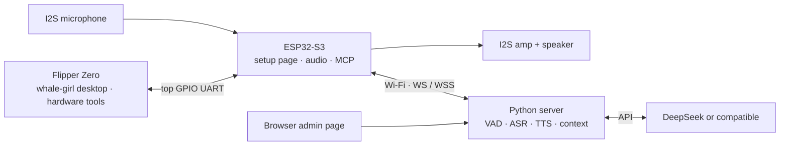

<p align="center">
  
</p>

<h1 align="center">DeepFlipper</h1>

<p align="center">
  <b>Whale Girl × Flipper Zero</b><br>
  A pixel AI companion that talks, moves, loves plain white rice, and can drive your Flipper's hardware
</p>

<p align="center">
  <a href="README.md">简体中文</a> · <b>English</b>
</p>

<p align="center">
  <a href="https://github.com/yichen115/DeepFlipper/releases"></a>
  
  
  
</p>

---

## Preview

<table>
  <tr>
    <td align="center" width="33%"></td>
    <td align="center" width="33%"></td>
    <td align="center" width="33%"></td>
  </tr>
  <tr>
    <td align="center"><b>Whale-girl desktop</b><br><sub>Time on the alarm clock, battery on the rice cooker;<br>listening / thinking / speaking as a small bubble</sub></td>
    <td align="center"><b>Whale Pet</b><br><sub>She tells you when she's hungry or sleepy;<br>a bowl of white rice makes her day</sub></td>
    <td align="center"><b>Catch Rice</b><br><sub>Catch falling rice with a bowl;<br>hold OK for stats and expressions</sub></td>
  </tr>
</table>

<sub>The GIFs are rendered by <code>scripts/render_readme_media.py</code> from the firmware's real drawing code, fonts and SD art, so the pixels match the device (orange only simulates the backlight). They are not recordings of hardware.</sub>

## What is it

DeepFlipper combines **Unleashed firmware + an ESP32-S3 voice module + a Python server**.
It replaces the dolphin on the Flipper Zero desktop with a 64×64 pixel whale girl who can:

- **Talk**: press OK, speak, and she answers out loud; her mouth follows the audio actually playing.
- **Act**: 23 Flipper tools over MCP, e.g. read NFC, learn IR, record Sub-GHz, drive GPIO.
- **Grow**: Whale Pet on the SD card — feed, pat, play, sleep and level up. She never dies and never guilt-trips you.
- **Stay light**: the server runs on an ordinary PC without a GPU. Speech recognition and synthesis run locally on the CPU; only the LLM goes through DeepSeek or another API.

> The logo shows the two characters together in a community project; it does not imply an official partnership with DeepSeek or Flipper.

**For normal use, download the matching firmware from [Releases](https://github.com/yichen115/DeepFlipper/releases).**
Flashing the prebuilt ESP32 image does not need ESP-IDF; you only need a toolchain to build from source.

Most detailed docs are in Chinese; the essentials are summarised below.

## Contents

- [Quick start](#quick-start)
- [Architecture](#architecture)
- [Features](#features)
- [Hardware and wiring](#hardware-and-wiring)
- [Installing prebuilt firmware](#installing-prebuilt-firmware)
- [Running the server](#running-the-server)
- [First-time setup](#first-time-setup)
- [Everyday use](#everyday-use)
- [Building from source](#building-from-source)
- [FAQ](#faq)
- [Credits](#credits)

## Quick start

| Step | What to do | Details |
|:---:|---|---|
| 1 | Wire the ESP32-S3, I2S microphone and amplifier to the Flipper's top GPIO header | [Hardware](#hardware-and-wiring) |
| 2 | Install the Flipper `.tgz` with qFlipper; flash the ESP32 with esptool | [Install](#installing-prebuilt-firmware) |
| 3 | Start the server with Docker, download the speech models, enter your DeepSeek API key | [Server](#running-the-server) |
| 4 | Turn on the Flipper's AI session, put the ESP32 on Wi-Fi and import its connection file | [Setup](#first-time-setup) |
| 5 | Back on the desktop, short-press OK and start talking | [Use](#everyday-use) |

## Architecture

The Flipper is great at talking to physical devices but has a tiny screen and MCU. The ESP32-S3 handles
Wi-Fi and audio, the PC handles recognition, the LLM and synthesis. All original Flipper features stay;
the whale girl becomes part of the system.



| Part | Role | Lives in |
|---|---|---|
| Flipper firmware | Whale-girl desktop, status, UART RPC, app and hardware dispatch | STM32 internal flash |
| SD resources | Animation frames, Whale Pet, on-demand capture tools | Flipper microSD |
| ESP32 firmware | Wi-Fi, device web page, I2S audio, RGB, MCP and the serial bridge | ESP32-S3 N16R8 |
| Python server | Speech recognition, LLM calls, speech synthesis, history, admin page | Windows / Linux host |

**Audio never goes over the Flipper UART**; the UART only carries state, settings and tool messages.
When you open NFC, Sub-GHz, IR and similar apps manually, the whale girl frees memory and pauses the AI link,
then resumes when you leave the app.

## Features

### Whale-girl desktop

The whole screen is a little pixel room. Information is drawn on objects instead of being stuck in the corners:

| Where | Shows |
|---|---|
| Alarm clock on the cabinet | Current time (follows the 12/24 h setting) |
| Rice cooker on the counter | Battery percentage; it steams while charging |
| Bubble above her head | Recording, thinking, speaking, muted, offline, error, locked; when idle, her wish (hungry, sleepy, wants to play) |
| Window | Day from 07:00, a starry night from 20:00 |

During a conversation she switches between 12 animations (listening, thinking, speaking, happy, shy…) with live lip sync.
If she is asleep in Whale Pet she sleeps on the desktop too, and she cheers when the Flipper levels up.

### Whale Pet

`Applications → Games → Whale Pet`, or short-press Right on the desktop.

| Key | Action |
|---|---|
| Left / Right | Choose the action at the bottom: Pat, Feed, Play, Catch, Sleep, Stats (Wake, Stats while asleep) |
| OK | Do it |
| Hold OK | Stats; Left/Right there opens the gallery of 19 expressions |
| Back / hold Back | Go back / exit |

- When she is hungry, sleepy or bored she says so, and the menu jumps to what she needs most.
- Successful care flashes a `+` next to the stat bar; cooldown, full and tired are explained instead of silently ignored.
- She wakes up by herself when rested, celebrates level-ups, and gets shy if you keep patting her.
- **Catch Rice**: hold Left/Right to move the bowl; rice balls are worth 3 points; you have 5 hearts.
- Stats never drop below 20; she never dies and never loses levels or affection. Saves are written to two checksummed slots in turn.

See [pet system (Chinese)](docs/pet-system.zh-CN.md).

### Device tools

**23 Flipper tools**, as reported by the device over MCP:

| Area | Available |
|---|---|
| System | Overall status, firmware / hardware / power info, foreground and PIN state, clock, sound and light alerts |
| Files & apps | SD listings, chunked file reads, storage, start / exit apps, short / long key presses |
| NFC | Protocol detection, identifier and public pages, reads with cached Classic keys, save `.nfc` |
| Infrared | Learn and save `.ir`, send a saved button |
| Sub-GHz | OOK650 RAW capture to `.sub`, time-limited send of saved files |
| RFID / iButton | Time-limited emulation of existing SD files |
| GPIO | Input/output and read/write on free pins (never the UART or power pins) |
| Jobs | Final results, cancel, resource release |
| App interface | Discover SDK apps registered on SD, list actions, start / query / stop across calls |

New apps plug in through an action table without ESP32 or server changes — see [App control (Chinese)](docs/app-control.zh-CN.md).

> **Limits**: system integration does not mean every menu item is an AI tool. Full encrypted card dumps, transit-card parsing,
> generic FSK, BLE/HID and so on still need per-feature work. An NFC identifier is not a decrypted card, a RAW capture is not a proven replay,
> and "sent" does not prove the target device reacted.

### Server and speech

| Stage | Choice | Notes |
|---|---|---|
| Voice activity | Silero VAD (onnxruntime) | One thread, negligible CPU |
| Recognition | SenseVoice int8 (sherpa-onnx) | ~240 MB, CPU only, no PyTorch |
| LLM | DeepSeek or any OpenAI-compatible API | The only step that needs Internet |
| Synthesis | MeloTTS (sherpa-onnx), Edge TTS optional | Local and offline; sentence pipeline |
| Admin | Built-in web page | No Java, Node, MySQL or Redis |

Synthesis starts with the first sentence and then uses the measured synthesis speed to decide when playback may begin:
on a fast machine it plays while synthesizing the rest; on a slow one it waits until everything is ready —
**a slightly later start, never choppy speech**. Replies are plain text without emoji; her desktop expression is picked from the wording.

Context is kept within a connection; on reconnect the last 6 turns from the past 24 hours are restored by default (0–12 configurable).

## Hardware and wiring

| Hardware | Notes |
|---|---|
| Flipper Zero + microSD | Runs this project's Unleashed build; needs the SD resources |
| ESP32-S3 N16R8 | 16 MB flash, 8 MB octal PSRAM; board `deepflipper-s3` |
| I2S microphone | INMP441-style, left channel |
| I2S amplifier + speaker | MAX98357A-style; never drive a speaker from a GPIO |
| RGB LED (optional) | One WS2812 on GPIO48; the dev board's LED works |
| Talk button | The dev board's BOOT / GPIO0 |

<details>
<summary><b>Flipper ↔ ESP32</b></summary>

| Flipper header | ESP32-S3 | Purpose |
|---|---|---|
| **13: TX / PB6** | **GPIO18: RX** | Flipper → S3 |
| **14: RX / PB7** | **GPIO17: TX** | S3 → Flipper |
| **11: GND** (or 8) | GND | Common ground |
| **1: 5V** | Through protection / a switch to the board's 5 V input | Optional module power; verify the load |

The control link is **UART1 on GPIO17/18**, not the log port usually labelled TX/RX on dev boards.
It starts at 9600, negotiates 460800 and falls back to 115200. Don't send plain text to the control UART.
</details>

<details>
<summary><b>Microphone, amplifier and LED</b></summary>

| Signal | S3 GPIO / wiring |
|---|---|
| Mic BCLK / SCK | GPIO5 |
| Mic WS / LRCLK | GPIO4 |
| Mic SD / DOUT | GPIO6 |
| Mic L/R | Left channel; usually tie to GND on INMP441-style boards |
| Amp BCLK | GPIO15 |
| Amp LRC / WS | GPIO16 |
| Amp DIN | GPIO7 |
| Amp power | Per module; MAX98357A usually 5 V, common ground with the S3 |
| Speaker | Across SPK+ / SPK−; never ground a MAX98357A speaker pin |
| WS2812 DIN | GPIO48 |
| Talk button | GPIO0, active low |

Output is Philips I2S with 32-bit left/right slots carrying the same mono data. Pins are defined in
[config.h](firmware/esp32/main/boards/deepflipper-s3/config.h); more in [hardware/README.md](hardware/README.md).

**Use one power source**: for debugging, power the S3 from USB and share ground with the Flipper; never tie USB 5 V and Flipper 5 V together.
</details>

<details>
<summary><b>RGB status LED</b></summary>

| State | Light |
|---|---|
| Missing server settings / waiting for Wi-Fi setup | Yellow blink |
| Connecting / reconnecting | Blue breathing |
| Ready | Dim green |
| Listening | Solid blue |
| Waiting for the reply | Purple breathing |
| Playing | Cyan, brightness follows the audio |
| Running a tool | Orange breathing |
| Connection error | Red blink |
| ESP32 standby / brightness 0 | Off |

Brightness is set on the **ESP32 web page → Sound and light** (0–100, default 12), or quickly from the Flipper's AI Assistant.
</details>

## Installing prebuilt firmware

Use the Flipper and ESP32 assets from the same release.

### Flipper

1. Download the Flipper F7 **`.tgz` full update package** — not a single `.bin`.
2. With the SD card in and USB connected, choose **Install from file** in qFlipper and pick the `.tgz`.
3. It contains the firmware and all SD resources. After reboot, check the desktop and **Settings → AI Assistant**.

Turn **AI session** off and disconnect the ESP32 before updating. If qFlipper restarts the device while uploading,
use the [SD-card install route (Chinese)](docs/flipper-update.zh-CN.md).

### ESP32-S3 N16R8

Unzip the ESP32 release and flash with the Espressif Flash Download Tool or plain esptool (no ESP-IDF needed):

```powershell
python -m pip install esptool
```

| Case | File | Address | Effect |
|---|---|---|---|
| First install / different partitions | `merged-binary.bin` | **0x0** | Resets settings; set up Wi-Fi and identity again |
| Same partitions (initial `ota_0` slot) | `deepflipper.bin` | **0x20000** | Keeps Wi-Fi, password and identity |

```powershell
# First install (resets device settings); change the port
python -m esptool --chip esp32s3 --port COM42 --baud 460800 write-flash 0x0 merged-binary.bin

# App-only upgrade: same partitions + initial ota_0; don't erase the chip
python -m esptool --chip esp32s3 --port COM42 --baud 460800 write-flash 0x20000 deepflipper.bin
```

If auto download mode fails: hold BOOT, tap RESET, release BOOT.

## Running the server

The server is a Python program; Docker is recommended (Docker Desktop on Windows, Docker Engine + Compose on Linux).
**No GPU needed**; an ordinary multi-core CPU with 4 GB+ RAM is a reasonable starting point.

```powershell
git clone https://github.com/yichen115/DeepFlipper.git
cd DeepFlipper

# The IPv4 address the ESP32 can reach (not 127.0.0.1)
python scripts/setup_local_server.py --host 192.168.1.10

# Download and verify the speech models: SenseVoice int8 (~240 MB), Silero VAD, MeloTTS (~167 MB)
python scripts/download_models.py

docker compose -f server/compose.local.yaml up -d --build
```

Open **http://127.0.0.1:8001/** on the server, sign in with the token from
`server/main/xiaozhi-server/data/admin-token.txt`, enter the API URL, model ID and API key under model settings,
then pick local MeloTTS or online Edge TTS and preview it.

> **"Container up" is not "voice ready"**: without model settings or files, the admin page (8001) works but the voice port (8000) may not be listening yet. Check "voice service ready" in the admin page.

<details>
<summary><b>Useful commands</b></summary>

```powershell
docker compose -f server/compose.local.yaml up -d             # start
docker compose -f server/compose.local.yaml ps                # status
docker compose -f server/compose.local.yaml logs -f --tail 100 # logs
docker compose -f server/compose.local.yaml up -d --build     # rebuild after code changes
docker compose -f server/compose.local.yaml down              # stop (data and models are kept)
```

Private settings live in `server/main/xiaozhi-server/data/`, models in `server/main/xiaozhi-server/models/`.
Old configs that select `FunASR` are migrated to `SherpaASR` automatically; the old `models/SenseVoiceSmall` (~1 GB) can be deleted.
</details>

<details>
<summary><b>Cloud server and remote admin</b></summary>

The voice port is **8000/TCP** and the device URL is `ws://reachable-ip:8000/xiaozhi/v1/`. Plain WS is fine on a trusted LAN;
use WSS on the Internet (see the [Caddy example](server/Caddyfile.example)). The admin port is published only on `127.0.0.1:8001`;
reach it over SSH:

```bash
ssh -L 8001:127.0.0.1:8001 user@server-ip
```
</details>

## First-time setup

1. Connect the module and enable **AI Assistant → AI session: ON** on the Flipper; wait for "UART connected".
2. Open **Setup: …** for the IP, hotspot name and **AP pass** (a random 12-character password).
3. Without saved Wi-Fi, join the `DeepFlipper-XXXX` hotspot and open the shown address (usually `http://192.168.4.1/`); the first login password is the AP pass.
4. Choose a **2.4 GHz** network on the ESP32 page and save; it is only stored once it gets an IP.
5. Switch back to your own network and open the ESP32 at the new IP shown on the Flipper.
6. Download the device identity from the ESP32 page, import it under "Devices" in the server admin, confirm the server URL, and generate the connection file.
7. Import that file on the ESP32, test the connection and authentication, then try the test tone and a full conversation.

## Everyday use

| Action | Result |
|---|---|
| Short OK on the desktop (AI on) | Start recording; speak when the mic bubble appears; press again to send |
| Long OK on the desktop (AI on) | System menu |
| Short Right on the desktop | Open Whale Pet |
| ESP32 BOOT click | Same record / send |
| AI Assistant → ESP32 standby | Turn off Wi-Fi and voice, keep UART wake-up |
| Admin "Conversation history" | Recognized text, replies and errors; clear per device to reset context |

If several desktop keys open a passport card with name / Mood / Level, the old `Dummy Mode` is on:
press Back, then short-press Up on the desktop and choose `Default Mode`.

## Building from source

All customized sources are in this repository (**no `git submodule update`**). Pinned dependencies and models:
[sources.lock.json](sources.lock.json), [models.lock.json](models.lock.json).

### Flipper firmware

Windows PowerShell with Git, Python and Pillow:

```powershell
python -m pip install pillow
.\scripts\build_flipper.ps1 -Package
```

Output: `build/release/flipper/flipper-z-f7-update-local.tgz`. FBT downloads its ARM toolchain on first use.

### ESP32 firmware

**ESP-IDF release/v6.1** installed with EIM, board `deepflipper-s3`:

```powershell
# Looks for eim-cli.exe next to the repo, on PATH, in D:\Espressif and C:\Espressif
.\scripts\build_esp32.ps1
# or point at it
.\scripts\build_esp32.ps1 -EimPath "D:\Espressif\eim-cli.exe"
# or inside an activated IDF 6.1 terminal
.\scripts\build_esp32.ps1 -UseCurrentEnvironment
```

Output: `build/release/esp32/` (`deepflipper.bin`, `merged-binary.bin` and flashing notes). Nothing is flashed automatically.

### Checks, tests and previews

```powershell
python -m unittest discover -s tests -v
uv run --with ziglang python scripts/test_native.py
uv run --with ziglang --with pillow python scripts/render_readme_media.py   # regenerate the GIFs above
python scripts/validate_project.py
```

Release packaging: `python scripts/package_release.py --version <tag>` (see [release guide, Chinese](docs/releases.zh-CN.md)).

## FAQ

<details>
<summary><b>UART offline?</b></summary>

Check GPIO17/18, crossed TX/RX, common ground, AI session and power. The TX/RX printed on boards is usually the GPIO43/44 log port.
</details>

<details>
<summary><b>Server connect_timeout?</b></summary>

Check the server IP, port 8000, firewall and routing. The ESP32 cannot reach your PC's localhost, and the IP may change on a new network.
</details>

<details>
<summary><b>Admin page works but no voice?</b></summary>

Make sure the admin page says the voice service is ready and the model settings and files are complete. Authentication passing does not mean ASR/TTS works; try the test tone and audio comparison first.
</details>

<details>
<summary><b>Choppy or noisy audio?</b></summary>

Play the same file on the PC and the device to compare; check amplifier power, common ground, short I2S wires and SPK+/SPK−. The ESP32 page shows per-turn audio diagnostics (packets, drops, decoder errors, gaps).
</details>

<details>
<summary><b>The AI says it did something but nothing happened?</b></summary>

Trust the tools the device actually reports and their final results. Opening an app, sending a key or "accepted" is not proof that the hardware action succeeded.
</details>

<details>
<summary><b>Regular Bluetooth headphones?</b></summary>

No. The ESP32-S3 only has BLE, not Classic HFP/A2DP.
</details>

## Credits

- [Flipper Zero firmware](https://github.com/flipperdevices/flipperzero-firmware)
- [Unleashed](https://github.com/DarkFlippers/unleashed-firmware)
- [XiaoZhi ESP32](https://github.com/78/xiaozhi-esp32)
- [XiaoZhi Python server](https://github.com/xinnan-tech/xiaozhi-esp32-server)
- [sherpa-onnx](https://github.com/k2-fsa/sherpa-onnx), [SenseVoice](https://github.com/FunAudioLLM/SenseVoice), [MeloTTS](https://github.com/myshell-ai/MeloTTS), [Silero VAD](https://github.com/snakers4/silero-vad)

Upstream directories keep their original licenses; baselines are listed in [sources.lock.json](sources.lock.json).
Characters and trademarks belong to their owners; the logo is a community illustration generated from user-provided references.
