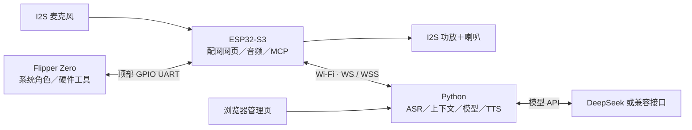

<p align="center">
  
</p>
<h1 align="center">DeepFlipper</h1>
<p align="center">鲸鱼娘 × Flipper Zero：能说话、会动、能调用设备工具的社区 AI 助手</p>

DeepFlipper 基于 **Unleashed 固件 + ESP32-S3 + Python 服务端**，将 Flipper Zero
桌面的海豚替换为鲸鱼娘像素角色，并加入语音对话、动作／嘴型联动和设备工具调用。
Logo 表达两个形象在本社区项目中的结合，不代表 DeepSeek 或 Flipper 官方合作。

**直接使用优先下载 [Releases 配套固件](https://github.com/yichen115/DeepFlipper/releases)。**
刷预编译 ESP32 固件无需安装 ESP-IDF；自行修改源码时才需要编译环境。

## 目录

- [背景与架构](#背景与架构)
- [功能与边界](#功能与边界)
- [硬件与接线](#硬件与接线)
- [预编译固件安装](#预编译固件安装)
- [服务端部署与运行](#服务端部署与运行)
- [首次配网与认证](#首次配网与认证)
- [日常使用](#日常使用)
- [RGB 状态灯](#rgb-状态灯)
- [三个部分的源码构建](#三个部分的源码构建)
- [创建 GitHub Release](#创建-github-release)
- [仓库内容与排除规则](#仓库内容与排除规则)
- [常见问题](#常见问题)

## 背景与架构

Flipper 擅长与实体设备交互，但屏幕和 MCU 资源有限。ESP32-S3 负责联网与音频，
电脑／服务器负责识别、模型与合成；Flipper 保留原有功能，鲸鱼娘成为系统行为。



| 部分 | 职责 | 运行／存储位置 |
|---|---|---|
| Flipper 固件 | 鲸鱼娘桌面、状态、UART RPC、应用和硬件调度 | STM32 内部 Flash |
| SD 资源／扩展 | 动画帧、原有 FAP、按需加载的采集工具 | Flipper microSD |
| ESP32 固件 | Wi-Fi、设备网页、I2S 音频、RGB、MCP 与串口桥接 | ESP32-S3 N16R8 |
| Python 服务端 | ASR、模型调用、TTS、对话记录和网页管理 | Windows / Linux 主机 |

鲸鱼娘本身不是一个占用前台的 FAP。新增采集功能通过 SD 上的
`/ext/apps/Tools/deepflipper_tools.fap` 按需运行，避免继续挤占内部 Flash。
**音频不经过 Flipper 串口**；串口传状态、配置和工具消息。

**正常应用优先使用内存**：手动打开 NFC、Sub-GHz、红外等应用时，先停止 AI 的 NFC 探测，
释放鲸鱼娘后台线程，并暂停 AI UART、等待对应 RPC 会话完全释放；退出应用后自动恢复。
暂停期间 AI 无法经 UART 控制设备，ESP32 会结束当前语音会话；返回桌面、UART 重新连上后可再次对话。
AI／USB RPC 发起的应用操作会保留命令所需的连接，避免中途断开自身。

```text
firmware/flipper/   Unleashed 源码和系统集成
firmware/esp32/     XiaoZhi 源码和 deepflipper-s3 板型
server/            Python 语音服务和同进程管理页
protocol/          自定义 RPC 协议
assets/branding/   Logo 与生成提示词
assets/whale-girl/  像素角色、动画帧和预览
hardware/          接线与硬件设计说明
scripts/           下载、构建、验证和发布打包脚本
tests/             服务端、网页与原生协议测试
docs/              最终规格与实现范围
build/             本机产物、日志和 Release 附件，不提交 Git
```

## 功能与边界

- **系统角色**：128×64 屏幕左侧为 64×64 鲸鱼娘，右侧显示状态、电量、时间；包含 12 套动画素材。
- **语音对话**：按键控制的半双工录音／发送，实际 PCM 输出驱动嘴型；英文设备菜单、中文网页，不显示长对话字幕。
- **设备网页**：Wi-Fi、Server URL／Token、音量、静音、麦克风、灯光及音频对比播放。
- **轻量后台**：模型 API、提示词、工具目录、设备认证、TTS 试听和对话记录，无需 Java、Node 后台、MySQL 或 Redis。
- **本地语音**：SenseVoice ASR、Silero VAD、MeloTTS CPU 合成；DeepSeek 回答仍走配置的模型 API。
- **上下文**：同一连接内有上下文；重连默认恢复同一 Device ID + Client ID 最近 24 小时内的 6 轮完整对话，最多 6000 字。后台可设置 0–12 轮，0 关闭恢复。

当前共 **20 项 Flipper 工具**，以本次设备实际通过 MCP 上报的列表为准：

| 类别 | 已接入 |
|---|---|
| 系统 | 整体状态、固件／硬件／电源信息、前台与 PIN 状态、时钟读取／设置、声光提醒 |
| 文件和应用 | SD 目录／应用列表、分段读取文件、存储容量、启动应用、RPC 应用退出、短按／逻辑长按 |
| NFC | 协议探测、实时标识／公共页面读取、使用已缓存 Classic 密钥读取、保存 `.nfc` |
| 红外 | 学习按键并保存 `.ir`，发送已保存文件的指定按键 |
| Sub-GHz | 内置射频 OOK650 RAW 接收并保存 `.sub`，限时发送已保存文件 |
| RFID / iButton | 限时运行 SD 上已有文件的模拟任务 |
| GPIO | 空闲扩展引脚输入／输出／读／写，不操作 UART 和共享电源引脚 |
| 任务 | 查询最终结果、请求取消、退出与资源释放确认 |

**系统级接入不代表每个菜单功能已经变成 AI 工具。**完整加密卡读写、公交卡业务解析、
通用 FSK 解码、BLE/HID、ADC/PWM、任意第三方应用内部动作仍需逐项适配。
NFC 标识不等于整卡解密；RAW 记录不证明可有效重放；本机发送结束不证明外部目标已响应。
用户已反馈基本对话／播放可用，新增采集、功耗和电气性能仍需实机验证。

详见 [实现状态](docs/implementation.md)、[最终规格](docs/final-spec.zh-CN.md)、[协议](protocol/README.md)。

## 硬件与接线

### 参考器件

| 硬件 | 说明 |
|---|---|
| Flipper Zero + microSD | 使用项目定制 Unleashed，需要 SD 资源和工具模块 |
| ESP32-S3 N16R8 | 16 MB Flash、8 MB Octal PSRAM；对应 `deepflipper-s3` |
| I2S 麦克风 | 如 INMP441 类模块，需匹配参考格式和左声道 |
| I2S 功放 + 喇叭 | 如 MAX98357A 类模块；喇叭不能直接接 GPIO |
| RGB LED，可选 | 单颗 WS2812，数据脚 GPIO48；可直接复用开发板板载灯 |
| 对话按钮 | 可复用开发板 BOOT / GPIO0 |
| 电源开关／保护 | 建议模块有独立物理开关；目前不是定版 PCB／BOM |

不同“小智开发板”自带 codec、显示器和功放，引脚未必相同，不能仅凭 N16R8 判断兼容。

### Flipper ↔ ESP32

| Flipper 顶部接口 | ESP32-S3 | 用途 |
|---|---|---|
| **13：TX / PB6** | **GPIO18：RX** | Flipper → S3 |
| **14：RX / PB7** | **GPIO17：TX** | S3 → Flipper |
| **11：GND**，8 也可 | GND | 公共地 |
| **1：5V** | 经保护／开关接开发板合适的 5V 输入 | 可选模块供电，需验证负载 |

控制链路为 **UART1 的 GPIO17/18**，不是开发板通常印有 TX/RX 的日志口。
先以 9600 发现设备，再协商 460800，失败后回退 115200。不要向控制串口发送普通文本。

### 麦克风、功放和灯光

| 模块信号 | S3 GPIO／接法 |
|---|---|
| 麦克风 BCLK / SCK | GPIO5 |
| 麦克风 WS / LRCLK | GPIO4 |
| 麦克风 SD / DOUT | GPIO6 |
| 麦克风 L/R | 当前读左声道；INMP441 类模块通常接 GND |
| 麦克风电源 | 按模块规格接 3.3V 与 GND |
| 功放 BCLK | GPIO15 |
| 功放 LRC / WS | GPIO16 |
| 功放 DIN | GPIO7 |
| 功放电源 | 按模块规格，MAX98357A 常用 5V；与 S3 共地 |
| 喇叭 | 跨接 SPK+ / SPK−；MAX98357A 喇叭端不能接地 |
| WS2812 DIN | GPIO48；板上已有灯时无需额外接线 |
| 对话按钮 | GPIO0，低电平有效 |

输出为 Philips I2S、32 位左右时隙，两个声道发送相同单声道数据。
引脚以 [config.h](firmware/esp32/main/boards/deepflipper-s3/config.h) 为准，详细说明见 [hardware/README.md](hardware/README.md)。

**供电只选一路**：调试可由 USB 给 S3 供电并与 Flipper 共地，不要直接并联 USB 和 Flipper 的 5V。
附件还需要考虑升压电源、功放峰值电流、断电 UART 隔离、防反接和机械支撑。
稳定电源、公共地与短 I2S 接线对掉线和杂音很重要。

RGB 是开发板上的器件，并非 ESP32-S3 芯片内置。不同板卡可能将 WS2812 接到 GPIO38 等引脚，
请以板卡原理图为准；当前统一使用 GPIO48、单颗 WS2812、GRB 顺序。
GPIO8/9/10 不再用于灯光；网页“灯光亮度”仍可控制，0 为灭灯，灯本体待机电流不会因此完全消失。
外接灯同样使用 WS2812，DIN 接 GPIO48，电源按模块规格并共地。

### 调试日志

参考 S3 的 UART0 日志为 **GPIO43 TX / GPIO44 RX，115200**。
只旁路监听时，CH340 **RX → GPIO43、GND → GND**，TX/VCC 不接。
日志口和控制 UART1 独立，二进制控制帧显示为乱码属于正常现象。

## 预编译固件安装

同一 Release 的 Flipper／ESP32 附件应配套使用，烧录预编译产物不需要安装 MCU 编译环境。

### Flipper

1. 下载 Flipper F7 **`.tgz` 完整更新包**，不要只刷其中一个 `.bin`。
2. Flipper 装好 SD、USB 连电脑，在 qFlipper 选择 **Install from file**，选中 `.tgz`。
3. 包中包含固件与 SD 资源；重启后检查鲸鱼娘桌面和 **Settings → AI Assistant**。

安装前先关闭 **AI session** 并关闭／断开 ESP32。若 qFlipper 在上传资源时导致旧固件重启，
可按 [更新与 SD 卡直装说明](docs/flipper-update.zh-CN.md) 绕过 USB 上传；不要运行上传中断后的残缺更新目录。

本机构建包位于 `build/release/flipper/flipper-z-f7-update-local.tgz`。
必要资源：`/ext/deepflipper/whale_frames.bin`、`/ext/apps/Tools/deepflipper_tools.fap`。

### ESP32-S3 N16R8

解压 ESP32 Release ZIP。可用 Espressif Flash Download Tool 等独立工具；
也可只安装 esptool，不用 ESP-IDF：

```powershell
python -m pip install esptool
```

选择实际串口，例如 `COM42`。自动下载模式失败时，按住 BOOT、点按 RESET，再松开 BOOT。
烧录期间建议断开 Flipper 模块供电，避免双电源并联。

| 场景 | 文件 | 地址 | 配置影响 |
|---|---|---|---|
| 第一次安装／分区不同 | `merged-binary.bin` | **0x0** | 覆盖 NVS，需重新配网和导出身份 |
| 相同分区 + 初始 `ota_0` 槽 | `xiaozhi.bin` | **0x20000** | 不全片擦除，可保留配置和身份 |
| OTA 槽切换过或不确定 | 不盲写应用地址，按完整安装说明恢复 | 见附件 | 完整安装后重新签发连接配置 |

以下二选一执行，串口请替换：

```powershell
# 第一次安装；会重置设备配置
python -m esptool --chip esp32s3 --port COM42 --baud 460800 write-flash 0x0 merged-binary.bin

# 仅升级应用：限相同分区 + 初始 ota_0；不要全片擦除
python -m esptool --chip esp32s3 --port COM42 --baud 460800 write-flash 0x20000 xiaozhi.bin
```

当前为 **DIO / 80 MHz / 16 MB Flash**，完整参数以包内 `flasher_args.json` 为准。
自行编译的产物在 `build/release/esp32/`。

## 服务端部署与运行

服务端是 Python 程序，无需烧录。推荐使用验证过的 Docker 部署方式：
Windows 用 Docker Desktop，Linux 用 Docker Engine + Compose 插件。
准备 Git、Python 3.10+、足够磁盘空间和 CPU 主机；建议至少 8 GB 内存，不要求显卡。

### 首次准备

以下命令均在仓库根目录执行，PowerShell／Linux 的主体步骤相同：

```powershell
git clone https://github.com/yichen115/DeepFlipper.git
cd DeepFlipper

# 填 ESP32 能访问的电脑／服务器 IPv4，不是 127.0.0.1
python scripts/setup_local_server.py --host 192.168.1.10

# 单独下载 ASR、VAD、本地 TTS 权重
python scripts/download_models.py

docker compose -f server/compose.local.yaml up -d --build
```

首次构建会安装 CPU PyTorch、ffmpeg、libopus 等依赖；耗时取决于网络。
SenseVoice 权重约 893 MiB，MeloTTS 包约 167 MB。已有 ASR/VAD 仅补 TTS 时：
`python scripts/download_models.py --tts-only`。

初始化脚本不会覆盖已有私有配置。电脑 IP 改变后，要更新生成连接配置时的地址和 ESP32 保存的 Server URL；
重复初始化不会自动覆盖旧地址。

### 后台与模型配置

1. 服务端本机打开 **http://127.0.0.1:8001/**。
2. 在本机文本编辑器打开 `server/main/xiaozhi-server/data/admin-token.txt`，复制管理口令登录。
3. “模型设置”填写 API Base URL、服务商实际提供的模型 ID、API Key，保存应用。
4. 选择本地 MeloTTS 或在线 EdgeTTS，用“试听所选语音”检查电脑端合成。

本地 ASR／TTS 可以离线处理语音，模型回答仍走配置的 API。EdgeTTS 依赖到微软服务的网络。
**容器 Up 不等于语音服务 ready**：缺少模型配置或权重时，8001 仍可用，8000 可能尚未启动，
以后台“语音服务就绪”为准。

### 常用命令

```powershell
# 正常启动
docker compose -f server/compose.local.yaml up -d
# 状态与日志
docker compose -f server/compose.local.yaml ps
docker compose -f server/compose.local.yaml logs -f --tail 100
# 修改服务端代码后重建
docker compose -f server/compose.local.yaml up -d --build
# 停止，保留目录挂载的数据和模型
docker compose -f server/compose.local.yaml down
```

私有配置在 `server/main/xiaozhi-server/data/`，模型在 `server/main/xiaozhi-server/models/`，均挂载保留。
程序入口为 [app.py](server/main/xiaozhi-server/app.py)。原生 Python 运行需要自行安装
[requirements.txt](server/main/xiaozhi-server/requirements.txt)、CPU PyTorch、ffmpeg/libopus，并加载 `data/server.env`；
Dockerfile 已包含运行环境，推荐复用。更多见 [server/README.md](server/README.md)。

### Linux 云服务器

语音端口为 **8000/TCP**，设备地址为 `ws://可达IP:8000/xiaozhi/v1/`。
可信局域网支持 WS，不需要域名或证书；公网建议 WSS，可参考 [Caddy 配置](server/Caddyfile.example)。
WS 保留 Token 认证，但不加密传输。

管理端口只发布到 `127.0.0.1:8001`，远程管理可通过 SSH：

```bash
ssh -L 8001:127.0.0.1:8001 user@服务器IP
```

然后在电脑打开 `http://127.0.0.1:8001/`。不要将管理员口令、模型 API Key 或服务端签名密钥填到 ESP32。

## 首次配网与认证

1. 接好模块，开启 Flipper **AI Assistant → AI session: ON**，等待 UART connected。
2. 打开 **Setup: …** 查看 IP、热点名和 **AP pass**。热点密码是设备随机生成的 12 位密码，没有统一默认值。
3. 无已存 Wi-Fi 时连接 `DeepFlipper-XXXX` 热点，打开显示的地址，通常为 `http://192.168.4.1/`。
   初始设备网页登录密码与 AP pass 相同。
4. ESP32 网页选择 **2.4 GHz Wi-Fi** 并保存；新网络拿到 IP 才保存，失败保留旧配置。
5. 成功后切回家庭网络，用 Flipper 显示的新 IP 访问 ESP32；设置热点通常约 15 秒后关闭。
6. ESP32 下载“设备身份”，在 Python 后台“设备连接”导入，确认 ESP32 可达的 Server URL，生成连接配置 JSON。
7. 将连接配置导入 ESP32，再测试连接与设备认证；文件会校验 Device ID／Client ID。
8. 单独测试提示音和完整对话。退出 Flipper 设置页回到桌面后，再让 AI 使用硬件工具。

| 配置 | 位置 |
|---|---|
| Wi-Fi、Server URL、Device Token、音量和灯光 | ESP32 设备网页 |
| 模型 API、提示词、TTS、上下文 | Python 后台 8001 |
| UART、IP／AP pass 查看、快捷设置、待机 | Flipper AI Assistant |

忘记设备网页登录密码时，正常上电后长按 BOOT／对话键 5 秒，开启恢复热点并恢复初始网页登录密码。
不要按住 BOOT 上电，那会进入烧录模式。

## 日常使用

| 操作 | 行为 |
|---|---|
| AI 开启时，桌面短按 OK | 开始录音；等 Listening 后讲话；再按发送 |
| AI 开启时，桌面长按 OK | 打开系统菜单 |
| ESP32 BOOT 单击 | 同样的录音／发送操作 |
| ESP32 网页“开始录音／发送这段录音” | 网页控制对话 |
| 后台“对话记录” | 查看识别文字、回复及处理错误；记录不等于已播放 |
| 后台“对话记录”→ 清空记录 | 按所选设备或全部设备删除记录并重置上下文，结束对应的语音会话 |
| AI Assistant → ESP32 standby | 关闭 Wi-Fi／语音，保留 UART 唤醒；先按 OK／BOOT 唤醒，联网后再录音 |

清空聊天时，先选择目标设备（或“全部设备”），再点击“清空该设备记录”／“清空全部记录”并确认。
这会永久删除相应文字记录、清除当前会话及重连恢复用的上下文；下次对话从头开始，
模型设置和设备凭据保留。清空后产生的新连接状态和新对话会重新记录。

ESP32 网页 **音频对比播放**支持内置人声、连续音或上传浏览器可解码的音频，最多 **30 秒／10 MB**。
先在电脑试听，再“在 ESP32 播放”；两边使用同一份 24 kHz 单声道采样，完整上传后播放，
支持停止，不额外增益、不写入 Flash。试听期间暂停 AI，结束后可重新对话。

如果对比播放流畅、实际对话卡顿，可按下列诊断项分段检查：
服务端“语音链路”可试听／下载原始合成与 Opus 还原音频；“设备连接”的“播放长语音测试”
会通过真正的对话连接发送固定测试语音，并可下载同一段原始样本用于 ESP32 缓冲播放对照。
“按真实对话分句测试”还会经过正常 TTS 分句队列，其下载样本来自实际发送 Opus 的解码还原。
测试不调用大模型或设备工具，麦克风数据不会进入 ASR；测试样本只保留最近一份在服务端内存中。
ESP32 网页“对话音频诊断”显示每轮的包数、丢弃、解码错误和间隔统计。
网络播放默认积累约 480 ms 缓冲，数据断粮后重新积累；播放结束会等待 I2S 尾部排空，
再切回空闲／省电。诊断只计入当前对话轮次，不含后续提示音或文件试听。

S3 蓝牙已关闭；待机恢复 Wi-Fi modem sleep，CPU 可在 80–240 MHz 调频。
在线 Expansion UART 仍使 Flipper 无法恢复原有深睡续航，闲置时物理关闭模块最省电，
实际电流／续航尚未测定。S3 只有 BLE，不支持普通耳机常用的 Classic HFP/A2DP。

## RGB 状态灯

ESP32 统一驱动 **GPIO48 上的一颗 WS2812（GRB）**，可复用开发板板载灯，
后续外接灯也使用同一协议。以下为当前固件实际实现的灯效：

| 状态 | 灯效 | 含义 |
|---|---|---|
| 缺少服务端配置／等待配网 | 黄色间歇闪烁 | 缺少有效 Server URL 或 Token，或未连上 Wi-Fi 且配置热点已开启；约每 1.5 秒亮 0.3 秒 |
| 正在连接／重连 | 蓝色呼吸 | UART 未连接、Wi-Fi 未连接，或服务端正在连接；呼吸周期约 1.6 秒 |
| 就绪、空闲 | 很暗的绿色常亮 | 等待下一轮对话；亮度约为设定值的 1/8 |
| 正在收音 | 蓝色常亮 | 处于 Listening，等待讲话或发送录音 |
| 等待回复／等待音频播放 | 紫色呼吸 | 进入 Thinking／回复处理阶段，尚未检测到实际音频输出帧 |
| 正在输出音频 | 青色，亮度随播放变化 | 由实际输出 PCM 的强弱分为三档，与鲸鱼娘嘴型联动 |
| 正在执行工具 | 橙色呼吸 | ESP32 正在处理设备工具任务；不代表外部目标已响应 |
| 连接异常／错误状态 | 红色间歇闪烁 | 网络已连但认证失败、连接超时、DNS／TLS／握手错误等，或应用报告错误；约每 2 秒亮 0.4 秒 |
| ESP32 standby | 灭灯 | 进入模块待机，关闭 Wi-Fi／语音，保留 UART 唤醒 |
| 灯光亮度为 0／模块物理断电 | 灭灯 | 前者只关闭灯光，后者切断整个模块电源 |

亮度在 **ESP32 网页 → 声音与灯光 → 灯光亮度（0–100）→ 保存声音与灯光** 中设置，
默认 **12**，保存后生效并保留到下次开机。Flipper 的 AI Assistant 也提供灯光亮度快捷调节。
设为 **0** 时，所有状态都不亮；WS2812 仍有供电时，灯珠自身的静态电流不会归零。

灯色随当前状态自动切换，暂不提供逐状态自定义颜色。多个活动重叠时，**工具执行优先于实际播放**；
基础状态先判断缺配置／配网，再判断连接，再判断服务端错误，最后使用应用状态。
因此网络掉线时通常显示蓝色重连；只有满足对应条件时才显示红色错误。
静音或音量为 0 时不显示实际播放的青色灯效，仍可显示其他状态。

灯效由 ESP32 本地计算，Flipper 无需发送每一帧颜色。更新频率最高 50 Hz，
颜色不变时不重复发送；灯光驱动初始化或写入失败会停用灯光并记录日志，语音和 UART 继续运行。
绿色就绪、工具灯或播放灯都是软件状态提示，实际连接、工具结果和扬声器声音仍以对应检查为准。

## 三个部分的源码构建

定制源码都在本仓库，**不需要 `git submodule update`**。
锁定依赖和模型下载信息见 [sources.lock.json](sources.lock.json)、[models.lock.json](models.lock.json)。

### Flipper 固件

Windows PowerShell，准备 Git、Python 和 Pillow：

```powershell
python -m pip install pillow
.\scripts\build_flipper.ps1 -Package
```

脚本下载缺失的锁定依赖、导出协议／动画、构建 SD 工具及完整更新包。
FBT 首次单独下载 ARM 工具链，与 ESP-IDF 无关。
主要输出：`build/release/flipper/flipper-z-f7-update-local.tgz`。

Linux 可安装 PowerShell 7 复用脚本，或手工执行：

```bash
python scripts/fetch_dependencies.py
python scripts/sync_protocol.py
python scripts/export_flipper_assets.py
cd firmware/flipper
FBT_NO_SYNC=1 ./fbt fap_deepflipper_tools DEBUG=0 -j8
mkdir -p applications/services/deepflipper/resources/apps/Tools
cp build/f7-firmware-C/.extapps/deepflipper_tools.fap applications/services/deepflipper/resources/apps/Tools/
FBT_NO_SYNC=1 ./fbt updater_package DEBUG=0 -j8
```

手工产物在 `firmware/flipper/dist/f7-C/`；根目录包装脚本会额外导出到 `build/release/flipper/`。

### ESP32 固件

使用 **ESP-IDF release/v6.1**，板型 `deepflipper-s3`，不使用 IDF 5.x。
自行通过 EIM 安装 SDK，不把 SDK／工具链提交到 Git。

```powershell
# 已注册 v6.1；默认查找父目录 eim-cli.exe 或 PATH 中的 eim
.\scripts\build_esp32.ps1
# 其他安装位置，替换为真实路径
.\scripts\build_esp32.ps1 -EimPath "D:\Espressif\eim-cli.exe" -Idf v6.1
```

已有激活好的 IDF 6.1 终端时：

```text
cd firmware/esp32
python scripts/build.py deepflipper-s3 --name deepflipper-s3
```

包装脚本验证 EIM 内部实际状态与产物哈希，输出到 `build/release/esp32/`；
直接调用板型脚本时，原始输出在 `firmware/esp32/build/`。只编译，不自动烧录硬件。
状态灯统一使用 WS2812 / GPIO48，不需要额外选择板型或构建版本。

### Python 服务端

源码不需要编译成固件，运行方式为：

```powershell
docker compose -f server/compose.local.yaml up -d --build
```

### 检查与测试

```powershell
python -m unittest discover -s tests -v
uv run --with ziglang python scripts/test_native.py
node tests/setup_ui_test.cjs
node tests/audio_preview_ui_test.cjs
node tests/admin_history_ui_test.cjs
python scripts/validate_project.py
```

原生测试需要先配置／编译 ESP32，取得 managed cJSON。完整语音依赖测试可以在 Docker 镜像内运行。
Node 只用于开发测试，不是后台运行依赖。编译／模拟通过不等于所有卡片、RF 或电气特性都已实机验证。

## 创建 GitHub Release

**固件放 Release Assets，不要强制添加 `build/` 到 Git。**
源码进入 Git；Release 单独存编译附件，避免每次固件都占用源码历史。

1. 提交准备发布的源码，重新构建配套 Flipper／ESP32，并运行检查。
2. 使用 [发布打包脚本](scripts/package_release.py)：

```powershell
python scripts/package_release.py --version v0.1.0-preview.1
```

输出：`build/github-release/v0.1.0-preview.1/`。

| 附件 | 用途 |
|---|---|
| `DeepFlipper-v0.1.0-preview.1-flipper-f7.tgz` | qFlipper 完整更新，含 SD 资源 |
| `DeepFlipper-v0.1.0-preview.1-esp32s3-n16r8.zip` | 完整／应用镜像、烧录参数和中文说明 |
| `SHA256SUMS.txt` | 附件校验值 |
| `SOURCE_STATE.json` | 提交／工作区状态与产物哈希，不含私有配置 |
| `RELEASE_NOTES.md` | 可粘贴到 GitHub 的中文发布说明 |

未提交的工作区默认拒绝打包。本机预览可加 `--allow-dirty`，发布说明会明确标记，
不能声称附件精确对应某个发布提交。示例版本名不代表远端已经创建 Release。

### 网页操作

1. 推送对应源码提交到 GitHub。
2. 仓库 → **Releases → Draft a new release**。
3. 创建 Tag，指向对应源码提交，填写版本标题。
4. 粘贴 `RELEASE_NOTES.md`，拖入打包目录中的附件。
5. 开发阶段勾选 **Set as a pre-release**，先存 Draft 检查，再发布。

安装了 GitHub CLI 的维护者也可用：

```powershell
git tag -a v0.1.0-preview.1 -m "DeepFlipper v0.1.0-preview.1"
git push origin v0.1.0-preview.1
$releaseFiles = Get-ChildItem -File build/github-release/v0.1.0-preview.1 | ForEach-Object FullName
gh release create v0.1.0-preview.1 @releaseFiles --draft --prerelease --verify-tag --title "DeepFlipper v0.1.0-preview.1" --notes-file build/github-release/v0.1.0-preview.1/RELEASE_NOTES.md
```

脚本不会提交／推送、创建 Tag 或发布远端 Release。详见 [发布指南](docs/releases.zh-CN.md)。

## 仓库内容与排除规则

| 内容 | 是否提交 |
|---|---|
| 定制源码、协议、脚本、测试、Logo、原始像素素材 | 是 |
| Flipper 必需字体等源码 | 是，是编译依赖 |
| 外部锁定依赖、SDK、FBT 工具链、managed components | 否，按脚本下载 |
| ASR／VAD／TTS 权重和模型缓存 | 否，单独下载 |
| 私有配置、Token、连接文件、对话数据库、临时录音 | 否 |
| 固件、ELF、日志、Release ZIP／TGZ、生图中间文件 | 否，固件走 Release |

`.gitignore` 不会自动取消已跟踪文件。生成文件可 `git rm --cached 路径`，保留本地副本后提交索引变更；
这不会删除旧提交里的历史副本。不要全局忽略所有 `.bin`／图片：鲸鱼娘帧文件与固定试听 WAV 是运行素材。

## 常见问题

**UART offline？** 查 GPIO17/18、交叉 TX/RX、公共地、AI session 和电源；
板上 TX/RX 标记往往是 GPIO43/44 日志口。控制帧乱码正常，日志看 UART0 的 `FlipperLink`。

**Server connect_timeout？** 查当前主机 IP、8000 端口、防火墙和路由；
ESP32 不能访问电脑的 localhost，主机换网后 IP 可能已变。

**后台可用但没语音？** 看服务是否 ready、模型 API 和权重是否齐全；
认证通过仍不等于 ASR/TTS 成功。先提示音、音频对比，再完整录音对话。

**声音小／杂音？** 电脑和设备播放同一文件对比，设备音量和静音单独生效；
检查功放电源、公共地、短 I2S 线和 SPK+/SPK−。合成音色风格与电气杂音是不同问题。

**AI 说做了但没结果？** 以实际上报工具与最终结果为准，退出 Flipper 设置页并检查 SD 模块。
打开应用、投递按键、任务 accepted 都不是硬件动作成功的证明。

**打开正常 NFC 等应用时 Out of memory？** 请使用包含内存让路修复的完整 Flipper TGZ 更新包。
修复会在本机应用运行期间归还 AI 后台栈和 UART RPC 资源；少数正在处理的 RPC 命令会让启动
暂时提示 `AI command is stopping; try again`，结束后重试即可。日志会记录暂停前后的空闲堆和最大连续块，
用于区分内存不足与碎片问题；物理读卡效果仍需在实际设备上确认。

**普通蓝牙耳机？** 当前 S3 没有 Classic HFP/A2DP，需要合适的外部音频模块或更换主机硬件。

## 致谢

- [Flipper Zero 官方固件](https://github.com/flipperdevices/flipperzero-firmware)
- [Unleashed](https://github.com/DarkFlippers/unleashed-firmware)
- [XiaoZhi ESP32](https://github.com/78/xiaozhi-esp32)
- [XiaoZhi Python 服务端](https://github.com/xinnan-tech/xiaozhi-esp32-server)
- [sherpa-onnx](https://github.com/k2-fsa/sherpa-onnx)、[MeloTTS](https://github.com/myshell-ai/MeloTTS)

各上游目录保留原许可证，基线见 [sources.lock.json](sources.lock.json)。
角色与商标归相应权利人，Logo 为参考用户素材生成的社区项目展示图，
[生成提示词](assets/branding/PROMPT.md)随项目保留。
