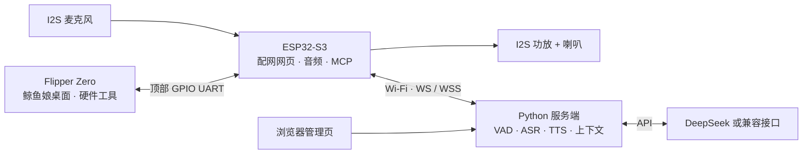

<p align="center">
  
</p>

<h1 align="center">DeepFlipper</h1>

<p align="center">
  <b>鲸鱼娘 × Flipper Zero</b><br>
  会说话、会动、爱吃白米饭，还能帮你操作 Flipper 硬件的像素 AI 小伙伴
</p>

<p align="center">
  <b>简体中文</b> · <a href="README.en.md">English</a>
</p>

<p align="center">
  <a href="https://github.com/yichen115/DeepFlipper/releases"></a>
  
  
  
</p>

---

## 预览

<table>
  <tr>
    <td align="center" width="33%"></td>
    <td align="center" width="33%"></td>
    <td align="center" width="33%"></td>
  </tr>
  <tr>
    <td align="center"><b>鲸鱼娘桌面</b><br><sub>时间在闹钟上、电量在电饭煲上，<br>录音／思考／说话用头顶小气泡表示</sub></td>
    <td align="center"><b>Whale Pet</b><br><sub>她会主动说饿了、困了，<br>喂一碗白米饭就开心</sub></td>
    <td align="center"><b>Catch Rice</b><br><sub>左右接米粒的小游戏，<br>长按 OK 看数值和表情</sub></td>
  </tr>
</table>

<sub>动图由 <code>scripts/render_readme_media.py</code> 调用固件里真实的绘制代码、字体和 SD 素材生成，与设备显示的像素一致（橙色只是模拟背光），不是实机录像。</sub>

## 这是什么

DeepFlipper 基于 **Unleashed 固件 + ESP32-S3 语音模块 + Python 服务端**，
把 Flipper Zero 桌面上的海豚换成一个 64×64 的像素鲸鱼娘，并让她：

- **能聊天**：按一下 OK 说话，她用语音回答，嘴型跟着实际播放的声音动。
- **能做事**：通过 MCP 调用 23 项 Flipper 能力，例如读 NFC、学红外、录 Sub-GHz、操作 GPIO。
- **能养成**：SD 卡上的 Whale Pet 小游戏，可以喂饭、摸摸、玩球、睡觉、慢慢长大，不会死、也不惩罚你。
- **很省心**：服务端只需要一台没有显卡的普通电脑；语音识别和合成都在本机 CPU 上跑，只有大模型走 DeepSeek 等 API。

> Logo 表达两个形象在本社区项目中的结合，不代表 DeepSeek 或 Flipper 官方合作。

**直接使用请下载 [Releases 配套固件](https://github.com/yichen115/DeepFlipper/releases)**；
刷预编译 ESP32 固件不需要安装 ESP-IDF，自己改源码时才需要编译环境。

## 目录

- [快速开始](#快速开始)
- [架构](#架构)
- [功能一览](#功能一览)
- [硬件与接线](#硬件与接线)
- [安装预编译固件](#安装预编译固件)
- [部署服务端](#部署服务端)
- [首次配网与认证](#首次配网与认证)
- [日常使用](#日常使用)
- [从源码构建](#从源码构建)
- [常见问题](#常见问题)
- [致谢](#致谢)

## 快速开始

| 步骤 | 做什么 | 详见 |
|:---:|---|---|
| 1 | 按接线表把 ESP32-S3、I2S 麦克风和功放接到 Flipper 顶部 GPIO | [硬件与接线](#硬件与接线) |
| 2 | 用 qFlipper 安装 Flipper `.tgz` 完整包，用 esptool 刷 ESP32 | [安装预编译固件](#安装预编译固件) |
| 3 | 在电脑上用 Docker 启动服务端，下载语音模型，填 DeepSeek API Key | [部署服务端](#部署服务端) |
| 4 | 开启 Flipper 的 AI session，给 ESP32 配网并导入连接配置 | [首次配网与认证](#首次配网与认证) |
| 5 | 回到桌面，短按 OK 开始说话 | [日常使用](#日常使用) |

## 架构

Flipper 擅长和实体设备交互，但屏幕和 MCU 资源有限。ESP32-S3 负责联网和音频，
电脑负责识别、大模型和合成；Flipper 保留原有全部功能，鲸鱼娘成为系统的一部分。



| 部分 | 职责 | 位置 |
|---|---|---|
| Flipper 固件 | 鲸鱼娘桌面、状态、UART RPC、应用与硬件调度 | STM32 内部 Flash |
| SD 资源／扩展 | 动画帧、Whale Pet、按需加载的采集工具 | Flipper microSD |
| ESP32 固件 | Wi-Fi、设备网页、I2S 音频、RGB、MCP 与串口桥接 | ESP32-S3 N16R8 |
| Python 服务端 | 语音识别、模型调用、语音合成、对话记录、网页管理 | Windows / Linux 主机 |

**音频不经过 Flipper 串口**，串口只传状态、配置和工具消息。手动打开 NFC、Sub-GHz、红外等应用时，
鲸鱼娘会先让出内存并暂停 AI 串口，退出应用后自动恢复。

<details>
<summary>仓库结构</summary>

```text
firmware/flipper/   Unleashed 源码和系统集成（鲸鱼娘桌面、Whale Pet、工具 FAP）
firmware/esp32/     基于 XiaoZhi 精简的 deepflipper-s3 固件
server/             Python 语音服务和同进程管理页
singing/            Windows GPU 唱歌服务、BreezeBlue 素材生成与 RVC 训练
protocol/           自定义 RPC 协议
assets/             Logo、像素角色、动画帧、预览图
hardware/           接线与硬件设计说明
scripts/            下载、构建、验证、预览和发布打包脚本
tests/              服务端、网页与原生代码测试
docs/               规格、实现记录和专题说明
build/              本机产物和 Release 附件，不提交 Git
```
</details>

## 功能一览

### 鲸鱼娘桌面

整屏是一间像素小屋，信息都画在物件上，而不是贴在四个角：

| 位置 | 显示 |
|---|---|
| 柜子上的闹钟 | 当前时间（跟随系统 12／24 小时制） |
| 台面上的电饭煲 | 电量百分比，充电时冒热气 |
| 她头顶的小气泡 | 录音、思考、说话、静音、断连、出错、锁定；空闲时显示她的心愿（饿了、困了、想玩） |
| 窗外 | 07:00 后是白天，20:00 后变成星空 |

语音对话时她会切换倾听、思考、说话、开心、害羞等 12 组动作，嘴型跟随实际播放的声音。
Whale Pet 里让她睡觉，桌面上她也会睡；升级时她会开心地蹦一会儿。

### Whale Pet 宠物应用

`Applications → Games → Whale Pet`，或在桌面短按右键进入。

| 操作 | 作用 |
|---|---|
| 左／右 | 切换底部动作：Pat、Feed、Play、Catch、Sleep、Stats（睡着时是 Wake、Stats） |
| OK | 执行当前动作 |
| 长按 OK | 数值页；在数值页按左右进入 19 组表情展览 |
| 返回／长按返回 | 返回上一页／直接退出 |

- 饿了、困了、无聊时她会冒气泡提醒，底部菜单也会自动停在她最需要的那一项。
- 数值变化按实际增减闪 `+`／`−`，满值不显示虚假加成；冷却中、吃饱了、太累了都会直接告诉你原因。
- 睡到精力满会自己醒来；升级有庆祝；连续摸摸会害羞。
- **Catch Rice**：按住左右移动饭碗接米粒，饭团算 3 分，有 5 颗心。
- 数值不会降到 20 以下，不会死亡，不扣等级和亲密度。两份带校验的存档轮流写入。

详见 [宠物系统](docs/pet-system.zh-CN.md)。

### 设备工具

当前共 **23 项 Flipper 工具**，以设备实际通过 MCP 上报的列表为准：

| 类别 | 已接入 |
|---|---|
| 系统 | 整体状态、固件／硬件／电源信息、前台与 PIN 状态、时钟读写、声光提醒 |
| 文件和应用 | SD 目录与应用列表、分段读取文件、存储容量、启动／退出应用、短按／长按 |
| NFC | 协议探测、标识与公共页面读取、用已缓存 Classic 密钥读取、保存 `.nfc` |
| 红外 | 学习按键并保存 `.ir`，发送已保存文件中的按键 |
| Sub-GHz | OOK650 RAW 接收并保存 `.sub`，限时发送已保存文件 |
| RFID / iButton | 限时模拟 SD 上已有的文件 |
| GPIO | 空闲扩展引脚的输入输出与读写（不碰 UART 和电源脚） |
| 任务 | 查询最终结果、请求取消、确认资源释放 |
| App 语义接口 | 发现 SD 上登记的 SDK 应用，查询动作和参数，跨调用开启／查询／停止 |

新 App 通过动作表接入，不需要为每个动作改 ESP32 和服务端，见 [App 控制接口](docs/app-control.zh-CN.md)。

> **能力边界**：系统级接入不等于每个菜单功能都已变成 AI 工具。完整加密卡读写、公交卡解析、通用 FSK、
> BLE/HID 等仍需逐项适配；NFC 标识不等于整卡解密，RAW 记录不证明能有效重放，本机发送结束不证明外部设备已响应。

### 服务端与语音

| 环节 | 方案 | 说明 |
|---|---|---|
| 人声检测 | Silero VAD（onnxruntime） | 单线程，几乎不占 CPU |
| 语音识别 | SenseVoice int8（sherpa-onnx） | 约 240 MB，纯 CPU，不需要 PyTorch |
| 大模型 | DeepSeek 或任意 OpenAI 兼容接口 | 对话模型 API |
| 语音合成 | MeloTTS（sherpa-onnx），可选 BreezeBlue、Edge TTS | MeloTTS 可离线；BreezeBlue 提供云端角色音色 |
| RVC 唱歌 | Windows 本机 NVIDIA GPU | 人声分离、角色变声与混音，后台练歌并缓存到设备播放；见 [唱歌安装与训练](singing/README.zh-CN.md) |
| 管理 | 同进程网页 | 不需要 Java、Node、MySQL、Redis |

本地 MeloTTS 会先合成第一句，然后根据实测的合成速度决定何时开播：机器够快就边播边合成，
机器太慢就自动等全部合成完再播，**宁可晚一点开口，也不断断续续**。
鲸鱼娘的回复是纯文本，不使用 emoji，桌面表情由回复用词自动判断。

同一连接内保留上下文；重连默认恢复同一设备最近 24 小时内的 6 轮对话（后台可设 0–12 轮）。

## 硬件与接线

| 硬件 | 说明 |
|---|---|
| Flipper Zero + microSD | 安装本项目的 Unleashed 定制固件，需要 SD 资源 |
| ESP32-S3 N16R8 | 16 MB Flash、8 MB Octal PSRAM，对应板型 `deepflipper-s3` |
| I2S 麦克风 | INMP441 类模块，读左声道 |
| I2S 功放 + 喇叭 | MAX98357A 类模块，喇叭不能直接接 GPIO |
| RGB LED（可选） | 单颗 WS2812，数据脚 GPIO48，可直接用开发板板载灯 |
| 对话按钮 | 复用开发板 BOOT / GPIO0 |

不同“小智开发板”自带的 codec、屏幕和功放引脚未必相同，不能只凭 N16R8 判断兼容。

<details>
<summary><b>Flipper ↔ ESP32 接线</b></summary>

| Flipper 顶部接口 | ESP32-S3 | 用途 |
|---|---|---|
| **13：TX / PB6** | **GPIO18：RX** | Flipper → S3 |
| **14：RX / PB7** | **GPIO17：TX** | S3 → Flipper |
| **11：GND**（8 也可） | GND | 公共地 |
| **1：5V** | 经保护／开关接开发板 5V 输入 | 可选模块供电，需验证负载 |

控制链路是 **UART1 的 GPIO17/18**，不是开发板上通常印着 TX/RX 的日志口。
先以 9600 发现设备，再协商 460800，失败回退 115200。不要向控制串口发普通文本。
</details>

<details>
<summary><b>麦克风、功放和灯光</b></summary>

| 模块信号 | S3 GPIO／接法 |
|---|---|
| 麦克风 BCLK / SCK | GPIO5 |
| 麦克风 WS / LRCLK | GPIO4 |
| 麦克风 SD / DOUT | GPIO6 |
| 麦克风 L/R | 读左声道，INMP441 类通常接 GND |
| 功放 BCLK | GPIO15 |
| 功放 LRC / WS | GPIO16 |
| 功放 DIN | GPIO7 |
| 功放电源 | 按模块规格，MAX98357A 常用 5V，与 S3 共地 |
| 喇叭 | 接 SPK+ / SPK−，MAX98357A 喇叭端不能接地 |
| WS2812 DIN | GPIO48 |
| 对话按钮 | GPIO0，低电平有效 |

输出为 Philips I2S、32 位左右时隙，两个声道发送相同的单声道数据。引脚以
[config.h](firmware/esp32/main/boards/deepflipper-s3/config.h) 为准，更多见 [hardware/README.md](hardware/README.md)。

**供电只选一路**：调试时可由 USB 给 S3 供电并与 Flipper 共地，不要把 USB 和 Flipper 的 5V 直接并联。
稳定电源、公共地和短 I2S 线对掉线和杂音很重要。
</details>

<details>
<summary><b>RGB 状态灯</b></summary>

| 状态 | 灯效 |
|---|---|
| 缺少服务端配置／等待配网 | 黄色间歇闪烁 |
| 正在连接／重连 | 蓝色呼吸 |
| 就绪、空闲 | 很暗的绿色常亮 |
| 正在收音 | 蓝色常亮 |
| 等待回复 | 紫色呼吸 |
| 正在播放 | 青色，亮度随声音变化 |
| 正在执行工具 | 橙色呼吸 |
| 连接异常／错误 | 红色间歇闪烁 |
| ESP32 standby／亮度为 0 | 灭灯 |

亮度在 **ESP32 网页 → 声音与灯光** 设置（0–100，默认 12），Flipper 的 AI Assistant 里也能快捷调节。
</details>

## 安装预编译固件

同一 Release 的 Flipper 和 ESP32 附件要配套使用。

### Flipper

1. 下载 Flipper F7 **`.tgz` 完整更新包**，不要只刷其中某个 `.bin`。
2. Flipper 装好 SD 卡、USB 连电脑，在 qFlipper 选择 **Install from file**，选中 `.tgz`。
3. 包里含固件和全部 SD 资源，重启后检查鲸鱼娘桌面和 **Settings → AI Assistant**。

安装前先关闭 **AI session** 并断开 ESP32。如果 qFlipper 上传资源时设备重启，
可以按 [SD 卡直装说明](docs/flipper-update.zh-CN.md) 绕过 USB 上传。

### ESP32-S3 N16R8

解压 ESP32 Release ZIP，用 Espressif Flash Download Tool 或只装 esptool（不需要 ESP-IDF）：

```powershell
python -m pip install esptool
```

| 场景 | 文件 | 地址 | 影响 |
|---|---|---|---|
| 第一次安装／分区不同 | `merged-binary.bin` | **0x0** | 覆盖配置，需要重新配网和导出身份 |
| 同分区升级（初始 `ota_0` 槽） | `deepflipper.bin` | **0x20000** | 保留 Wi-Fi、登录密码和身份 |

```powershell
# 第一次安装（会重置设备配置），串口按实际修改
python -m esptool --chip esp32s3 --port COM42 --baud 460800 write-flash 0x0 merged-binary.bin

# 仅升级应用：同分区 + 初始 ota_0，不要全片擦除
python -m esptool --chip esp32s3 --port COM42 --baud 460800 write-flash 0x20000 deepflipper.bin
```

自动下载模式失败时，按住 BOOT、点按 RESET，再松开 BOOT。烧录时建议断开 Flipper 供电。

## 部署服务端

服务端是 Python 程序，推荐 Docker：Windows 用 Docker Desktop，Linux 用 Docker Engine + Compose。
**不需要显卡**，普通多核 CPU、4 GB 以上内存即可起步。

```powershell
git clone https://github.com/yichen115/DeepFlipper.git
cd DeepFlipper

# 填 ESP32 能访问到的电脑／服务器 IPv4，不是 127.0.0.1
python scripts/setup_local_server.py --host 192.168.1.10

# 下载并校验语音模型：SenseVoice int8 约 240 MB，Silero VAD，MeloTTS 约 167 MB
python scripts/download_models.py

docker compose -f server/compose.local.yaml up -d --build
```

然后在服务端本机打开 **http://127.0.0.1:8001/**，用 `server/main/xiaozhi-server/data/admin-token.txt`
里的口令登录，在“模型设置”填写 API 地址、模型 ID 和 API Key，选择本地 MeloTTS 或在线 Edge TTS 并试听。

> **容器 Up 不等于语音服务就绪**：缺少模型配置或模型文件时，管理页 8001 仍可用，语音端口 8000 可能尚未启动，以后台“语音服务就绪”为准。

<details>
<summary><b>常用命令</b></summary>

```powershell
docker compose -f server/compose.local.yaml up -d             # 启动
docker compose -f server/compose.local.yaml ps                # 状态
docker compose -f server/compose.local.yaml logs -f --tail 100 # 日志
docker compose -f server/compose.local.yaml up -d --build     # 改代码后重建
docker compose -f server/compose.local.yaml down              # 停止（数据和模型保留）
```

私有配置在 `server/main/xiaozhi-server/data/`，模型在 `server/main/xiaozhi-server/models/`，均通过目录挂载保留。
从旧版本升级时，旧配置里的 `FunASR` 会自动换成新的 `SherpaASR`；旧的 `models/SenseVoiceSmall`（约 1 GB）可以删除。
更多见 [server/README.md](server/README.md)。
</details>

<details>
<summary><b>Linux 云服务器与远程管理</b></summary>

语音端口为 **8000/TCP**，设备地址为 `ws://可达IP:8000/xiaozhi/v1/`。可信局域网可用 WS；
公网建议 WSS，可参考 [Caddy 配置](server/Caddyfile.example)。管理端口只发布到 `127.0.0.1:8001`，远程管理用 SSH 转发：

```bash
ssh -L 8001:127.0.0.1:8001 user@服务器IP
```

不要把管理员口令、模型 API Key 或服务端签名密钥填到 ESP32。
</details>

## 首次配网与认证

1. 接好模块，在 Flipper 打开 **AI Assistant → AI session: ON**，等待 UART connected。
2. 打开 **Setup: …** 查看 IP、热点名和 **AP pass**（设备随机生成的 12 位密码）。
3. 没有已存 Wi-Fi 时连接 `DeepFlipper-XXXX` 热点，打开显示的地址（通常是 `http://192.168.4.1/`），初始登录密码同 AP pass。
4. 在 ESP32 网页选择 **2.4 GHz Wi-Fi** 并保存；拿到 IP 才会保存，失败时保留旧配置。
5. 切回家里的网络，用 Flipper 显示的新 IP 访问 ESP32。
6. 在 ESP32 网页下载“设备身份”，到服务端后台“设备连接”导入，确认 Server URL，生成连接配置 JSON。
7. 把连接配置导入 ESP32，测试连接与认证，再试提示音和完整对话。

| 配置 | 在哪里改 |
|---|---|
| Wi-Fi、Server URL、Device Token、音量和灯光 | ESP32 设备网页 |
| 模型 API、提示词、语音合成、上下文 | 服务端后台 8001 |
| UART、IP／AP pass、快捷设置、待机 | Flipper AI Assistant |

忘记设备网页密码时，正常上电后长按 BOOT 5 秒开启恢复热点（不要按住 BOOT 上电，那会进入烧录模式）。

## 日常使用

| 操作 | 行为 |
|---|---|
| AI 开启时桌面短按 OK | 开始录音，头顶出现麦克风气泡后说话，再按一次发送 |
| AI 开启时桌面长按 OK | 打开系统菜单 |
| 桌面短按右键 | 打开 Whale Pet |
| ESP32 BOOT 单击 | 同样的录音／发送 |
| AI Assistant → ESP32 standby | 关闭 Wi-Fi 和语音，保留 UART 唤醒 |
| 后台“对话记录” | 查看识别文字、回复和错误；可按设备清空并重置上下文 |

<details>
<summary><b>播放卡顿怎么排查</b></summary>

- ESP32 网页 **音频对比播放** 可以播放内置人声或上传的音频（最多 30 秒／10 MB），先在电脑试听再在设备播放，用来区分网络和电气问题。
- 服务端“语音链路”可试听／下载原始合成与 Opus 还原音频；“设备连接”里的长语音测试和按真实对话分句测试走真正的对话连接。
- ESP32 网页“对话音频诊断”显示每轮的包数、丢弃、解码错误和间隔统计。
- 设备会先积累约 480 ms 缓冲再开播，数据断档后重新积累；播放结束会等 I2S 尾部排空。
</details>

如果桌面多个按键都打开显示设备名、Mood、Level 的资料卡，说明处于旧的 `Dummy Mode`：
先按返回退出，再在桌面短按上，选择 `Default Mode`。

## 从源码构建

定制源码都在本仓库，**不需要 `git submodule update`**。锁定依赖和模型见
[sources.lock.json](sources.lock.json)、[models.lock.json](models.lock.json)。

### Flipper 固件

Windows PowerShell，准备 Git、Python 和 Pillow：

```powershell
python -m pip install pillow
.\scripts\build_flipper.ps1 -Package
```

脚本会下载缺失的锁定依赖、生成主页和宠物素材、编译两个 FAP 并打完整更新包，
输出 `build/release/flipper/flipper-z-f7-update-local.tgz`。FBT 首次会自行下载 ARM 工具链。

### ESP32 固件

使用 **ESP-IDF release/v6.1**（通过 EIM 安装），板型 `deepflipper-s3`：

```powershell
# 自动查找项目上一级、PATH、D:\Espressif、C:\Espressif 下的 eim-cli.exe
.\scripts\build_esp32.ps1
# 或者明确指定
.\scripts\build_esp32.ps1 -EimPath "D:\Espressif\eim-cli.exe"
# 已经在激活好的 IDF 6.1 终端里
.\scripts\build_esp32.ps1 -UseCurrentEnvironment
```

输出到 `build/release/esp32/`（`deepflipper.bin`、`merged-binary.bin` 和烧录说明），只编译不烧录。

### 检查、测试和预览

```powershell
python -m unittest discover -s tests -v
uv run --with ziglang python scripts/test_native.py
uv run --with ziglang --with pillow python scripts/render_readme_media.py   # 重新生成本页动图
python scripts/validate_project.py
```

<details>
<summary><b>创建 GitHub Release</b></summary>

固件放 Release Assets，不要把 `build/` 加进 Git。

```powershell
python scripts/package_release.py --version v0.1.0-preview.1
```

输出在 `build/github-release/<版本>/`：Flipper 完整 `.tgz`、ESP32 ZIP、`SHA256SUMS.txt`、
`SOURCE_STATE.json` 和中文 `RELEASE_NOTES.md`。工作区有未提交改动时默认拒绝打包。
脚本不会提交、推送、打 Tag 或发布，详见 [发布指南](docs/releases.zh-CN.md)。
</details>

<details>
<summary><b>仓库内容与排除规则</b></summary>

| 内容 | 是否提交 |
|---|---|
| 定制源码、协议、脚本、测试、Logo、像素素材、预览图 | 是 |
| 外部锁定依赖、SDK、FBT 工具链、managed components | 否，脚本下载 |
| ASR／VAD／TTS 模型 | 否，`download_models.py` 下载 |
| 私有配置、Token、连接文件、对话数据库、临时录音 | 否 |
| 固件、ELF、日志、Release 附件 | 否，走 Release |

不要全局忽略 `.bin` 和图片：鲸鱼娘帧库和固定试听 WAV 是运行素材。
</details>

## 常见问题

<details>
<summary><b>UART offline？</b></summary>

检查 GPIO17/18、TX/RX 交叉、公共地、AI session 和供电。板上印的 TX/RX 往往是 GPIO43/44 日志口。
</details>

<details>
<summary><b>Server connect_timeout？</b></summary>

检查服务端 IP、8000 端口、防火墙和路由。ESP32 不能访问电脑的 localhost，换网后 IP 可能变了。
</details>

<details>
<summary><b>后台能打开，但没有语音？</b></summary>

看后台是否显示语音服务就绪、模型 API 和模型文件是否齐全。认证通过不等于识别／合成成功，
先试提示音和音频对比，再完整对话。
</details>

<details>
<summary><b>声音小或有杂音？</b></summary>

在电脑和设备上播放同一文件对比；检查功放供电、公共地、短 I2S 线和 SPK+/SPK−。音色风格和电气杂音是两回事。
</details>

<details>
<summary><b>AI 说做了但没结果？</b></summary>

以设备实际上报的工具和最终结果为准，退出 Flipper 设置页后再试。打开应用、投递按键、任务 accepted 都不是硬件动作成功的证明。
</details>

<details>
<summary><b>打开 NFC 等应用时 Out of memory？</b></summary>

请安装包含内存让路修复的完整 Flipper 更新包。个别正在处理的 AI 命令会让启动提示 `AI command is stopping; try again`，稍后重试即可。
</details>

<details>
<summary><b>能用普通蓝牙耳机吗？</b></summary>

不能。ESP32-S3 只有 BLE，没有 Classic HFP/A2DP。
</details>

## 致谢

- [Flipper Zero 官方固件](https://github.com/flipperdevices/flipperzero-firmware)
- [Unleashed](https://github.com/DarkFlippers/unleashed-firmware)
- [XiaoZhi ESP32](https://github.com/78/xiaozhi-esp32)
- [XiaoZhi Python 服务端](https://github.com/xinnan-tech/xiaozhi-esp32-server)
- [sherpa-onnx](https://github.com/k2-fsa/sherpa-onnx)、[SenseVoice](https://github.com/FunAudioLLM/SenseVoice)、[MeloTTS](https://github.com/myshell-ai/MeloTTS)、[Silero VAD](https://github.com/snakers4/silero-vad)

各上游目录保留原许可证，基线见 [sources.lock.json](sources.lock.json)。角色与商标归相应权利人，
Logo 为参考用户素材生成的社区项目展示图。

更多：[实现记录](docs/implementation.md) · [最终规格](docs/final-spec.zh-CN.md) · [协议](protocol/README.md) · [交接文档](HANDOFF.md)
