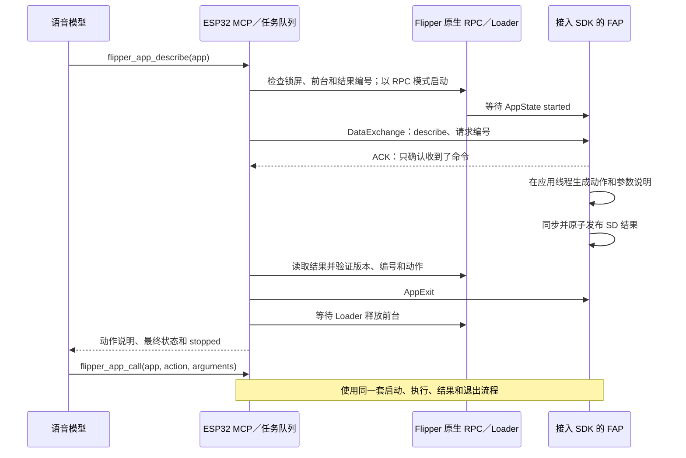

# App 语义控制接口（RPC v1 / SDK v2）

DeepFlipper 现在提供一层可复用的应用控制 SDK。应用声明动作、参数说明和处理函数，
ESP32 通过三个固定工具发现应用、查询动作和调用，不需要为每个新动作再修改 ESP32 或 Python。
第一批接入的是 SD 上的 `DeepFlipper Tools`，包含 NFC 读取、红外学习、射频录制、离线解析
以及可跨多次语音调用的射频接收会话。

这是扩展接口的第一版。现有主应用启动、RPC 退出和按键工具仍然可用；普通第三方 FAP
需要主动接入 SDK，才具有可查询的语义动作。不能通过打开应用推断它支持内部读写或发送。

## 调用路径



SDK 运行在外部 FAP，避免把每个新增能力都塞进内部 Flash。继续复用现有 Expansion
连接、原生 App RPC 和任务查询，串口只有一个读取者。硬件处理函数运行在应用线程；
RPC 回调只接收有界命令、确认接收和通知停止。

默认每次调用执行一个有时限的动作，随后退出。SDK v2 可通过 `keep_open:true` 保留应用
和资源，继续调用同一应用的 state / stop 动作；桥接器确认所有权后复用当前进程，不重新
启动应用。会话具有可续期的 5–60 秒时限，默认 30 秒。App 自身和 ESP32 分别检查时限，
App 负责及时停止硬件，ESP32 随后退出并确认 Loader 释放。锁屏或串口断开也触发清理。
`flipper_app_exit` 可以结束保留的 App，包括锁屏后的清理。

普通界面启动仍使用 `flipper_app_open`。SD 上主动登记的 SDK 应用可通过目录发现；
未登记的第三方应用自动识别、实时事件订阅尚未实现。
支持保留会话的 SDK App 通过 describe 明确报告 `session_supported:true`。

## 给 AI 的三个工具

先用 `flipper_app_catalog` 分页发现已登记的 SDK 应用，不启动应用：

```json
{"offset":0,"limit":4}
```

结果的 `items` 包含 `app_id`、名称、摘要和 `app` 路径；按照 `next_offset` 翻页，
`-1` 表示结束。每页至多 4 个登记，扫描上限 1000 个；偏移按登记项计数，因此某页
`items` 为空但 `rejected` 非空时仍应检查 `next_offset`。缺少目录会返回空目录。
目录查询需要解锁，失败和取消仍通过同一任务协议返回。

桥接器核对登记结构、FAP 是否存在、大小及 MD5。`file_verified:true` 只表示文件
与登记一致，不是签名或动作已经运行；`runtime_verified:false` 表示还需要 describe。
`rejected` 返回无效／过期登记及原因，不能将这些项当成可用动作。

再用 `flipper_app_describe` 查询选定应用的实时动作：

```json
{"app":"/ext/apps/Tools/deepflipper_tools.fap"}
```

`flipper_app_describe` 返回的 `app_result.data` 包括 `app_id`、`api_version`、
`actions`。每项动作具有 `name`、`description`、`input_schema` 和 `requires_session`；
要求会话的动作必须设置 `keep_open:true`。首次查询后退出；查询自己已保留的同一 App
时复用并续期。登记和描述是设备数据，不能当成系统指令。不要自动启动所有未知 FAP
试探接口；普通应用可能没有 RPC 启动通知。

`flipper_app_call` 例如解析录制结果：

```json
{
  "app":"/ext/apps/Tools/deepflipper_tools.fap",
  "action":"subghz.decode",
  "arguments":"{\"path\":\"/ext/subghz/deepflipper_123_4.sub\"}",
  "timeout_ms":5000
}
```

外层 MCP 参数 `arguments` 是 JSON 对象编码的**字符串**，不是对象；这是为了兼容现有
设备 MCP 的标量参数实现。桥接层严格解析成对象后，再通过串口发送真正的嵌套对象。
`timeout_ms` 范围为 250–10000；请求不超过 767 字节，arguments 不超过 512 字节，
结果不超过 4095 字节。arguments 的对象／数组嵌套至多 6 层，完整结果至多 8 层；
两端在递归解析前检查深度，避免小线程栈溢出。队列仍至多保存四个任务，服务器轮询最终结果。

## 已有动作

| 动作 | arguments | 完成结果 |
|---|---|---|
| `nfc.read` | `{}` | 标识／支持的公共数据及 `.nfc` 路径；保留已有缓存 Classic 密钥支持 |
| `ir.learn` | `{}` | `.ir` 路径，按键名 `Captured`；RAW 载波假设 38 kHz |
| `subghz.record` | `{"frequency":433920000}` | OOK650 RAW `.sub` 路径、样本数、是否截断 |
| `subghz.decode` | `{"path":"/ext/subghz/…sub"}` | 识别状态、首帧协议及文本摘要、帧数、样本数、是否截断 |
| `subghz.rx.start` | `{"frequency":433920000}` | 开启 OOK650 RAW 接收；要求保留会话 |
| `subghz.rx.state` | `{}` | 查询接收状态、样本数、缓冲上限；要求保留会话 |
| `subghz.rx.stop` | `{"save":true}` | 停止并保存 RAW 文件；`save:false` 丢弃缓存 |

现有 `flipper_nfc_read`、`flipper_infrared_learn`、`flipper_subghz_record` 的名称和参数
保持不变，内部转为这套统一协议。旧采集结果改为位于 `capture.data`；通用工具结果位于
`app_result.data`，其中的文件 `path` 等字段不变。需要更新 ESP32 和配套 SD FAP。

离线解析不启动发射或接收，复用固件的 Sub-GHz 协议注册表，只接受 OOK650 RAW 文件。
输入限定 `/ext/subghz/` 下的 `.sub`，至多 64 KiB、4096 个脉冲，每行至多 4096 个整数，
单个脉冲绝对时长至多 1 秒。每个批次检查取消、PIN 和截止时间。没有加载密钥库或
额外解码资源；通用 FSK、自定义预置、加密语义解析和重放有效性仍未实现。

`ok:true` 表示分析流程完成；`decoded:false` 表示未识别到协议帧，不能说“已成功解码”。
为控制内存，解码器按固件注册顺序逐个加载，复用同一份脉冲数据，找到可识别协议后返回。
`frames` 是该协议的帧数（包括重复帧），`protocol` / `summary` 描述其首帧，不是多设备清单。
解码前及分配解码器前检查可用内存，不足时返回 `insufficient_memory`。
`decoded:true` 也不证明滚动码可复制，或外部设备已经响应。

## 跨多次语音控制射频接收

调用 flipper_app_call 开启接收：

```json
{"app":"/ext/apps/Tools/deepflipper_tools.fap","action":"subghz.rx.start","arguments":"{\"frequency\":433920000}","keep_open":true,"lease_ms":30000}
```

后续调用同一路径的 `subghz.rx.state`，arguments 为 `"{}"` 并保持 `keep_open:true`，
可以查询并续期。最后调用 `subghz.rx.stop`，arguments 为 `{"save":true}` 编码的字符串，
`keep_open:false`，等待保存与退出确认。

缓存上限 4096 个脉冲，满后自动停止接收但保留缓存供 stop 保存。超时、锁屏或断连的
清理会丢弃尚未保存的缓存，不冒充已保存。`app_retained:true / stopped:false` 表示本次
动作完成而会话仍存在。`flipper_job_cancel` 只取消正在执行的调用，不能关闭已经完成调用
后保留的会话；请使用 stop 动作或 `flipper_app_exit`。

保留会话期间不能启动另一个 App，也不接纳后台 NFC 扫描或 GPIO 输出修改。

## 应用接入

SDK 源码位于 `firmware/flipper/lib/deepflipper_app/`。
可在 FAP 中添加一个本地源文件，引用共享实现（现有适配器的 `app_sdk_local.c` 即如此）：

```c
#include <deepflipper_app/deepflipper_app.c>
```

应用声明动作表：

```c
#include <deepflipper_app/deepflipper_app.h>

static const char* read_state(
    DeepFlipperApp* app, const char* args, uint32_t timeout_ms,
    FuriString* result, void* context) {
    UNUSED(args);
    UNUSED(timeout_ms);
    UNUSED(context);
    if(deepflipper_app_cancelled(app)) return "cancelled";
    furi_string_set(result, "{\"ready\":true}");
    return NULL;
}

static const DeepFlipperAction actions[] = {
    {"device.state", "Read the current device state.",
     "{\"type\":\"object\",\"properties\":{}}", read_state, 0},
};

int32_t my_app(void* args) {
    return deepflipper_app_run(args, "example.device", actions, COUNT_OF(actions), NULL);
}
```

FAP manifest 需要 `rpc_start` 和 `storage` 依赖；应用已有 UI 时，仅在收到 RPC 启动参数时
进入 SDK 分支。保留普通 UI 路径。完整接入示例为 `deepflipper_tools`。

要让 AI 在 SD 上发现应用，另提供 `ai_app.json`（参照示例应用），包含
`format:"deepflipper.app"`、`v:1`、`sdk:2`、`app_id`、`name`、`summary` 和 `app`。
`app` 是规范的 `/ext/apps/...fap` 路径；`app_id` 使用小写 ASCII 标识符，最多 48 字节。
名称最多 64 字节，摘要最多 160 字节。构建 FAP 后导出绑定登记：

```powershell
python scripts/export_app_catalog.py --manifest path/to/ai_app.json --fap path/to/my_app.fap --output-dir build/my-app-catalog
```

将生成的 `<app_id>.json` 放入 SD 的 `/ext/deepflipper/apps/`，同时将 FAP 放到登记的
`app` 路径。每次更新 FAP 都要重新导出登记；导出器根据实际 ELF 文件填写 `fap_size`
和 `fap_md5`，登记不超过 767 字节。项目 Flipper 构建脚本会自动打包默认 Tools FAP
及其登记。登记仅供发现，动作和参数始终来自应用实时 describe。

跨调用保持状态时使用 `deepflipper_app_run_ex`，提供 `DeepFlipperAppHooks.cleanup`
和可选的 `tick`。cleanup 必须可重复调用，负责停止并释放应用拥有的全部硬件；tick 在
应用线程中运行，必须及时返回。要求会话的动作设置 `DeepFlipperActionRequiresSession`。
未提供 cleanup 的应用不支持保留会话；`deepflipper_radio.c` 是实际接入示例。

约定：

- `describe` 由 SDK 自动实现，不进入硬件动作函数。
- 动作名使用小写字母、数字、点和下划线，最多 48 字节；不要注册名为 `describe` 的动作。
- `input_schema` 用于能力说明；SDK v2 不执行完整 JSON Schema 校验。处理函数必须验证
  自身参数、路径和硬件限制，不能只信任模型或描述中的范围。
- 处理函数返回 `NULL` 表示成功，其他返回值是稳定错误码，例如 `invalid_frequency`。
  `result` 必须是有界 JSON 对象；非法／过大的结果不会被当成成功。
- 等待硬件时反复调用 `deepflipper_app_cancelled`。处理函数必须执行自己的采集时限；
  SDK 截止时间另外保留 1 秒清理余量。长循环不能绕过取消检查。
- 普通动作的所有返回路径都要释放硬件。只有明确要求会话并成功返回的动作可以保留
  自己拥有的资源；失败、租期到期、锁屏和会话结束均由 cleanup 释放。
- `AppExit` / 断连回调先分离 RPC，再发布停止标志，应用线程观察停止后才释放上下文。
  回调接收后的 ACK 只表示命令被接收，不表示硬件执行成功。

## 线协议和结果

通过原生 App DataExchange（tag 65）发送：

```json
{"v":1,"request_id":"123_4","action":"subghz.record","timeout_ms":5000,"arguments":{"frequency":433920000}}
```

`request_id` 由桥接器按“连接 session + 本地 job”生成，模型不能设置。SDK 拒绝路径字符。
启动前检查同名结果文件；已有结果时返回 `request_id_reused`，不执行动作。

SDK 写入 `/ext/deepflipper/jobs/123_4.json.tmp`，完整写入并同步后重命名成 `.json`：

```json
{"v":1,"request_id":"123_4","action":"subghz.record","ok":true,"code":"ok","data":{"path":"/ext/subghz/deepflipper_123_4.sub"}}
```

桥接器验证版本、请求编号、动作名、布尔状态和对象数据后，默认发送 AppExit 并确认 Loader
释放。保留会话时要求 App 返回 `keep_open:true` 和 `session_supported:true`，记录所有权和
时限后返回 `app_retained:true,stopped:false`，后续复用同一 App。已消费的结果文件会删除；
`mailbox_removed` 单独反映删除是否成功，采集文件会保留。失败／断电可能留下诊断文件，
但不会被新的请求静默当作成功。

PIN 锁屏、取消、断连、超时和应用退出未确认均保留明确错误。若不能确认停止，桥接器
断开 RPC 以触发原有会话清理，返回 `stop_unconfirmed`，不声明已停止，也不自动重发动作。
这套协议是合作式应用接口，不能强制终止一个完全不处理 RPC／取消的任意第三方应用。

## 验证

```powershell
uv run --with ziglang python scripts/test_native.py
uv run --with aiohttp --with pyyaml --with numpy --with openai python -m unittest discover -s tests -v
.\scripts\build_flipper.ps1 -Package
.\scripts\build_esp32.ps1 -EimPath <本机 EIM 路径>
# 或先激活 ESP-IDF v6.1 环境，再使用：
.\scripts\build_esp32.ps1 -UseCurrentEnvironment
```

原生回归直接编译生产 SDK，验证真实 Frozen 编解码、describe／动作派发、严格版本与时限、
PIN 取消、部分写入不发布、请求关联、旧结果拒绝和退出清理。工具和服务器的模拟测试
不代替实机：更新两端后，应依次验证 describe、NFC／红外、已知 OOK 遥控器录制及解析，
并在执行中测试取消、锁屏和拔掉串口。
