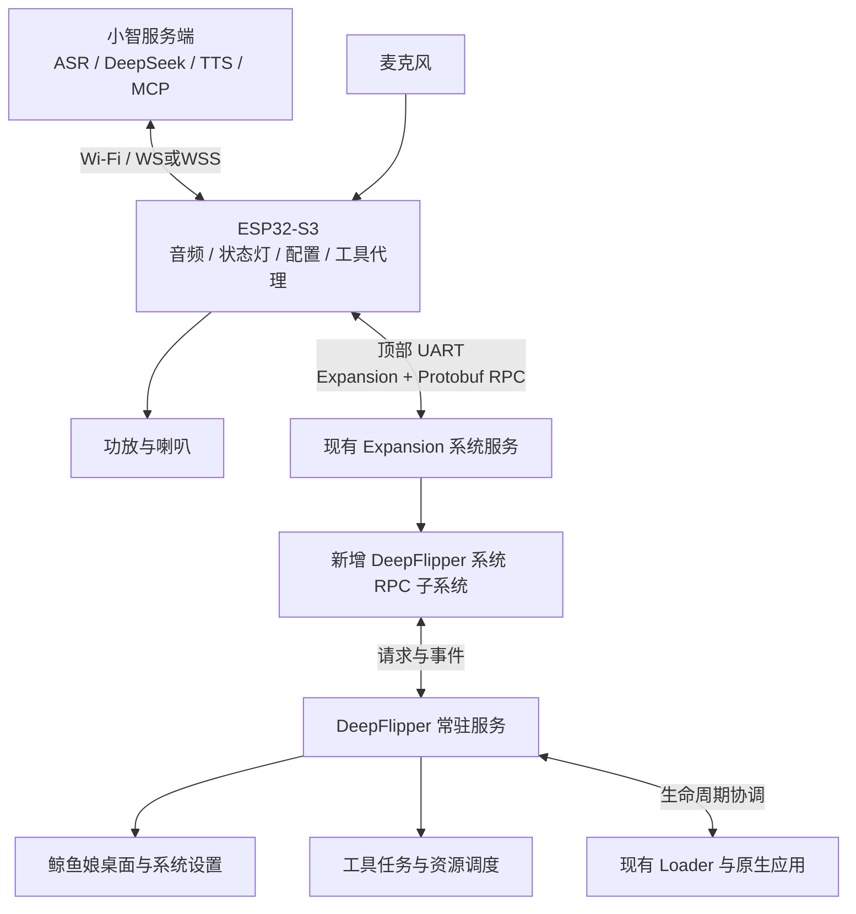

# DeepFlipper 最终规格

本文件是项目唯一方案规格，汇总当前已确认方向、实现约束和验收条件。尚未确认的器件与实测参数列在末尾，不将设计目标写成已实现功能。

## 1. 产品与范围

基于 **Unleashed** 自定义 Flipper 固件，把系统海豚吉祥物替换为 **DeepSeek 鲸鱼娘**，加入常驻 AI 助手、ESP32-S3 语音插件、模型工具调用和系统设置。

| 已确定项目 | 最终要求 |
|---|---|
| 固件基础 | `refer/unleashed-firmware`，保留其原生与第三方功能；当前参考 HEAD `4c5e74cce` |
| 吉祥物 | 已选定的横屏 Q 版全身，保留围裙鲸鱼标志和鲸尾 |
| 角色形态 | 系统桌面角色＋常驻助手服务，不依赖前台助手 FAP |
| 对话输出 | **语音回答，不显示聊天字幕**；屏幕显示角色、状态与必要错误提示 |
| 插件 | 顶部 GPIO 插接 ESP32-S3，集成麦克风、功放／喇叭、RGB 灯和物理电源开关 |
| 供电 | Flipper 顶部 5 V；插件独立开关，关闭后 Flipper 本地功能照常使用 |
| 通信 | 一组 3.3 V UART，使用官方 Expansion 封包和系统 Protobuf RPC |
| AI 后端 | 小智服务端负责 ASR、DeepSeek、TTS；ESP32 负责 Wi-Fi 和音频终端 |
| 工具 | 有明确参数、状态和真实执行结果的 NFC／Sub-GHz／IR／BLE 适配器 |
| 系统设置 | Wi-Fi、服务器与认证、音量／静音、麦克风、灯效、模块状态与恢复 |
| 默认行为 | AI 手动开启；查看设置不自动上电；本地角色不依赖插件或网络 |
| 本机语言 | 首版英文菜单／状态，不显示聊天字幕；语音按用户语言回答 |

首版优先按键半双工对话。语音唤醒和播放中可靠打断须单独验证后启用，不能只因使用 S3 就承诺全双工。开机桌面就是鲸鱼娘；打开原生应用时交出屏幕，退出应用后回到角色桌面。

## 2. 系统结构



Flipper 管理本地 UI、硬件能力和任务；ESP32 管理录音、播放、网络、设备配置与 LED；服务端管理识别、模型、语音合成和模型工具编排。音频直接在 ESP32 与服务端之间流动，不经 UART；角色动画保存在 Flipper 本地。

新增 `applications/services/deepflipper/` 常驻服务，桌面和设置页是服务客户端。保留原 `dolphin` 的成长／心情、deed 和持久化接口兼容性，更换用户看到的角色和相应文案；不对内部符号做盲目全局改名。

## 3. 硬件与顶部接口

采用带 PSRAM 的 ESP32-S3；精确板型／模组、Flash、codec 和 GPIO 在画板前确认。已有小智语音板优先复用其音频驱动；若自制 PCB，再按兼容性选择 I2S 麦克风、codec／功放和喇叭，不能直接用 GPIO 推喇叭。

| Flipper 顶部编号 | 信号 | 用途 |
|---|---|---|
| 1 | 5 V | 插件输入电源，经保护、滤波、专用开关和稳压 |
| 8、11 | GND | 公共地 |
| 13 | PB6 / USART TX | 接 S3 UART RX |
| 14 | PB7 / USART RX | 接 S3 UART TX |
| 15、16 | PC1 / LPUART TX、PC0 / RX | 保留，不同时建立第二条助手链路 |
| 9 | 3.3 V | 不与插件稳压器输出并联；若隔离电路需要常供电逻辑，再单独核算 |
| 10、12 | PA14 / SWCLK、PA13 / SWDIO | 保留调试 |
| 2–7 | PA7、PA6、PA4、PB3、PB2、PC3 | 默认不占用，可预留透传／测试点 |

基本连接为 1、11、13、14 四个触点。S3 端引脚须避开其 Flash、PSRAM、USB、启动配置和音频占用。麦克风、功放和 LED 都接 S3，不额外占 Flipper 顶部信号；精确连线依据实际硬件图，不凭开发板丝印猜测。

布局需留 Wi-Fi 天线净空，考虑 Flipper NFC／RFID 感应区、Sub-GHz 天线和其他扩展附件的使用。麦克风与喇叭隔振、设置声孔与声腔，电源／LED PWM 不应引入明显音频噪声；接口防插反并有机械支撑。预留模块烧录、调试、BOOT／RESET 和关键电源测试点。

## 4. 手动断电与独立运行

```text
Flipper 顶部 5 V
   → 输入保护与滤波
   → 插件专用电源开关／负载开关
       ├→ 稳压 → S3、麦克风／codec、RGB 灯
       └→ 功放 → 喇叭
```

物理开关同时关闭 S3、麦克风、功放与灯，硬件默认功放静音。关闭时系统仍显示本地鲸鱼娘，菜单、NFC／RF／BLE 等原生功能正常使用；只失去语音、联网问答和新的模型调用。默认不自动上电，不因重连、开机或查看设置违背物理 OFF。

**电源开关和系统设置中的“AI 启用”分开：**首版以物理开关断电；软件可结束会话，但只有增加可控负载开关 EN 和相应 GPIO 后才具备真正的软件断电／上电功能，未实现时不提供虚假电源开关。没有开关位置检测时，系统显示“模块未连接”，不把断电、未插和故障混成已知原因。

Flipper 顶部 5 V 是共享外设电源，不能关闭 AI 时直接切掉其他附件所需的 5 V。完全依赖该电源的 S3 无法先发握手给自己开电；Flipper 侧设置／启动流程负责启用供电，硬开关决定插件是否取电。若以后加入外部调试供电，应明确 OFF 的覆盖范围，防回灌和旁路供电。

UART 等跨域信号需硬件支持断电高阻／Ioff，防止通过 TX 或上拉反向给已关机模块供电；串联电阻不能默认替代隔离。正常关闭依次停止新请求、收音与播放，清理会话任务，关闭连接、释放串口，再隔离／断电；突然硬关闭则按断连流程做有界清理，不等待永久 ACK。

现有 Expansion worker 会持有 `furi_hal_power_insomnia_enter()`，禁用时需正常退出并平衡引用，停止心跳、计时器和无效重试，避免 S3 断电后 Flipper 仍不能休眠。前台应用和屏幕关闭时暂停不必要的角色读帧与刷新。

Wi-Fi 发射、最大计划音量、低电池和上电浪涌的电流／压降／温升必须实测。低电量策略至少能提示并限制高耗电功能或结束 AI，不让插件拖垮本机；具体阈值待测。尚无数据支持最大喇叭功率或续航承诺。

## 5. 通信、配置事件与任务协议

### 5.1 唯一串口拥有者

现有 Expansion 服务唯一持有 UART。官方协议从 9600/8N1 握手，再协商运行速率，当前优先 460800；协商／RPC 建连失败或已建立链路丢失时，停止旧链路并重新握手，回退 115200，保持到 ESP32 重启。未检测到设备本身不触发首次降速。DATA 每帧最多 64 字节，逐帧确认、异或校验、心跳周期小于 250 ms。必须在目标固件启用相应 Expansion UART 监听；较高速率的电气稳定性需真机验证。

S3 使用独立通信任务和统一发送队列，角色状态、工具、设置与结果按消息类型复用；不混裸 JSON、调试日志或第二个 UART 接收器。消息长度、缓冲、队列、待确认请求都有上限；取消、结果和按键优先，嘴型只留最新值。音频不走该链路，也不持续传屏幕帧；避免大文件／屏幕流挤占实时状态。

### 5.2 独立系统 RPC

新增助手系统 RPC 子系统，与 system/storage/app/gui 并列，接口直达 `RECORD_DEEPFLIPPER`。它不依赖 App Data Exchange 的前台应用上下文，也不抢原生应用的回调。维护对应的 Protobuf 定义、字段编号和生成流程，固定固件／S3 协议版本，验证既有 USB／BLE RPC 兼容性。

消息包含协议版本、模块身份、连接 session、请求 ID／序号；对话事件包含 turn ID，任务包含 job ID，配置包含 revision／事务 ID。消息覆盖能力协商、状态快照、情绪、嘴型、输入、配置、工具提交／查询／取消和最终结果。没有聊天字幕消息或动态字形传输要求。

**Flipper 设置到 S3 的方向也必须实现：**S3 虽是 RPC 客户端，仍需订阅系统事件。Flipper 用户改设置／按键时，服务发布带事务 ID 的模块命令事件，S3 接收执行后发 `module.command_result` 等请求回报；不能只实现“S3 请求、Flipper 回答”。重连先同步实际状态和配置版本，避免旧 UI 覆盖新模块设置。

状态机至少区分未启用、启动、缺配置、连接、就绪、收音、等待回答、工具执行、实际播放、停止和故障；电源、网络、会话、任务状态分别记录。网络 `tts/start` 不等于实际已经出声。断线清空旧轮次事件，不自动重发结果未知的输出任务。

### 5.3 模型工具链

服务端向模型提供实际启用的工具 → 小智设备端 MCP 请求到 S3 → S3 通过同一 Expansion 会话发送助手系统 RPC／原生 RPC → Flipper 执行 → 结果回到服务端 → 模型据真实结果回答。凭据、恢复出厂等本地设置管理操作不默认暴露为模型工具。

长任务区分 accepted 与最终 result，先确认入队并返回 job ID，再异步执行；不能在 RPC／UI／音频回调中等待读卡。当前小智工具回调调度到主线程，也须通过任务提交与查询等非阻塞方式适配。所有任务有超时、取消、busy、unsupported、invalid_args、link_lost 和 hardware_error 等明确结果。

输出任务以请求 ID 去重，自动重试不得产生重复发射。限长、限次数、限持续时间；文件使用已枚举 ID 并约束目录，不让模型直接传任意 CLI、内存地址或寄存器操作。硬件完成发送只说明本机执行，不自动等于目标设备状态已改变。

## 6. 工具范围与应用共存

**覆盖目标是当前固件实际提供的主要功能，不限于首版已接入的两项硬件工具。**应用发现／启动和具体动作分开计数；只有参数、执行路径、停止／取消及最终结果都接通的动作，才向模型宣告可用。表中“已有入口”是源码接口，不等于已完成 MCP 工具适配。

| 功能组 | AI 覆盖目标 | 现有源码入口与需要适配的部分 |
|---|---|---|
| 本机状态与任务 | 电量、固件、SD、连接、当前应用、任务查询／取消 | System／Property／DeepFlipper RPC；已接入状态、电源／硬件信息、锁屏／前台／RPC 应用状态及任务查询／取消 |
| 应用与第三方 FAP | 枚举已安装应用、启动、状态、退出、传递支持的参数 | Loader／App RPC；任意 FAP 内部动作仍需其 RPC 或专用适配，启动成功不等于动作完成 |
| SD 文件 | 枚举、读取、保存、重命名和删除相关业务文件 | Storage RPC；采用枚举文件 ID 与路径边界，避免任意路径拼接 |
| Sub-GHz | 接收／解码、保存、发送支持的已保存信号、停止发送 | 接收／发送库与 Sub-GHz App RPC；原生 RPC 已有加载和发送路径，频段／协议错误必须回报 |
| 红外 | 学习／保存信号、枚举遥控器按键、按键发送与停止 | Infrared worker；App RPC 已支持加载遥控器、按名称或索引发送 |
| NFC 13.56 MHz | 协议检测、读取、保存、模拟，以及固件支持的协议写入 | scanner／poller／listener／协议插件；App RPC 可加载已保存卡片并进入模拟，并非通用现场读卡接口 |
| 125 kHz RFID | 识别／读取、保存、模拟，支持卡种的写入 | lfrfid worker；App RPC 的保存文件加载／模拟路径可复用，读取和写入另适配 |
| iButton／1-Wire | 读钥匙、保存、模拟，支持类型的写入及已实现总线操作 | ibutton worker／协议组、1-Wire CLI 插件；iButton App RPC 可加载文件并模拟 |
| Flipper BLE | 蓝牙状态、广播、已有 profile 和蓝牙 HID 远控 | Bt service／BLE profile；切换 profile 会重启 C2 并影响手机连接；通用扫描／GATT 客户端不能冒充现有 API |
| USB／BLE HID、BadUSB | 键盘／鼠标／媒体控制，运行已选择的脚本、停止、执行状态 | HID profiles 与原生应用；第三方脚本执行结果必须以实际运行状态为准 |
| GPIO／ADC／PWM／桥接 | 可用引脚读写／输入模式、采样、输出及已有串口桥接 | Gpio RPC 提供基础数字 IO，其他功能使用 HAL／应用适配；保留助手 UART 与供电资源 |
| U2F | 启动、连接与认证流程状态，维持原应用交互语义 | 原生 U2F 应用；打开应用不代表已完成主机端认证 |
| 系统操作与设置 | 日期时间、通知、背光／振动／蜂鸣、蓝牙与已实现设置 | System RPC、通知和设置服务；不通过任意 CLI／内存写实现，凭据和恢复出厂不默认作为普通对话工具 |
| JavaScript、工具／游戏 FAP | 枚举和启动，以及应用公开的具体操作 | Loader／各应用接口；未知第三方内部功能不能仅凭菜单名称推断可操作 |
| ESP32 附加能力 | 网络、外接语音、RGB，以及将来单独实现的 S3 BLE 等 | 与本体工具分开命名；只宣告实际接入的硬件和驱动 |

实现优先复用原生 RPC 和原生应用，把缺失动作作为明确适配层处理。当前 ESP32 已处理项目 PB.Main 500／501 和已接入工具所用的原生响应、多包返回与异步 App 状态路由；新增协议仍须验证通用解析和边界，不能把其他原生消息误当成错误并重置会话。扩展仍使用同一个 UART 接收器／发送队列。

系统鲸鱼娘保持常驻；读取／发射等动作可由原生应用或独立 SD 工具适配执行。避免把所有应用流程复制进 STM32 内部常驻服务：当前固件到 C2 区域只剩约 6.8 KiB，新增代码仍须经过边界检查。长任务保留超时／取消／断连清理，原生模拟或持续发送需要可靠的停止路径；本机完成发送不自动证明外部设备已经响应。

常驻服务不占前台 Loader app thread，因此可以打开原生 NFC 等应用，但硬件仍独占。首版保守策略：桌面允许助手硬件任务；启动任何前台应用前，停止或完成助手任务并确认资源释放；前台运行期间新硬件工具返回 busy，语音与不争用资源的状态查询继续；退出后恢复。

Loader 启动协调覆盖菜单、快捷键和 RPC 等正常路径，要有准入与有界确认，不能仅异步监听 BeforeLoad 就认定已释放资源，也不能强行解锁 Loader。NFC 分配失败可能触发检查，需防止检查空闲后被另一任务占用的竞态。直接绕过标准路径的第三方程序须单独兼容测试。

助手可在桌面通过库完成短任务，也可调用 Loader 打开支持 RPC 的原生应用，屏幕／按键归原生应用；两种方式按工具实现明确选择。不在任意应用上强制覆盖整只角色。锁屏／PIN、静音、SD 错误和硬件提示继续有效；默认锁屏不启动新硬件工具。

## 7. 角色、音画联动与文字

屏幕横屏 128×64、单色。角色使用 [当前动画素材](../assets/whale-girl/README.zh-CN.md) 的 64×64 全身与围裙标志，首批待机、倾听、思考、说话、开心、害羞、惊讶、挥手、难过、生气、困倦、点头共 12 组。

**不显示用户识别文字或 AI 回答字幕。**鲸鱼娘按原始 64×64 像素显示在左侧，不缩小；右侧显示简短状态信息。完整回答由喇叭播放；语音静音时显示静音状态，测试／故障结果仍有简短本地提示，不偷偷退回长字幕需求。

鲸鱼娘桌面采用固定左右布局，角色区域为 x=0..63、y=0..63，不缩小或裁切。右栏 x=70..125 按信息重要性分为三段：

| 区域 | 显示内容 | 规则 |
|---|---|---|
| 顶部 | 时间、电池内百分比 | 字号小，位置固定；电量来自 Flipper 本机 |
| 中间 | 当前阶段、单行上下文提示 | 阶段使用粗体；提示说明下一步操作或等待原因 |
| 底部 | VOL 音量、MIC 麦克风开关 | 标签左对齐、值右对齐；AI 关闭或模块断连时均显示 `--` |

不再单独列出 `AI` 和 `LINK Online`：串口连接成功不能证明 Wi-Fi、TLS 或服务端可用。状态优先级是 AI 关闭、模块未连接、模块上报／本地 NFC 阶段；待机时麦克风关闭会替换普通待机提示，静音回复不显示正在发声。图标只保留锁定与后台窗口提醒，放在底部两行的列间空隙，静音由 VOL 值表达。其他应用和系统警告页面仍使用原有状态栏。

| 场景 | 主状态 | 上下文提示 |
|---|---|---|
| AI 开关关闭 | AI off | Local mode |
| 未建立模块会话 | No link | Check ESP32 |
| 配网／配置 | Setup | AI settings |
| 正在连接 | Connecting | Please wait |
| 待机 | Ready | OK: talk |
| 录音 | Listening | Click: send |
| 思考／等待模型 | Thinking | Please wait |
| 实际音频播放 | Speaking | Voice reply |
| NFC 检测 | NFC scan | Hold a card |
| 待机且麦克风关闭 | Mic off | AI settings |
| 静音或零音量下的回复 | Reply | Audio muted |
| 已知通用错误 | Error | AI settings |

AI 开启时，Flipper 桌面短按 OK 开始录音，显示 Listening 后讲话，再短按 OK 结束并发送；长按 OK 打开系统菜单。AI 关闭时保留原有桌面操作。ESP32 上的对话按钮（GPIO0／BOOT）也可单击录音／发送；不要按住按钮上电，长按 5 秒用于配网恢复。ESP32 网页在状态区下方使用同一个按钮切换“开始录音／发送这段录音”。通用 Error 不擅自推断 Wi-Fi 密码错误、认证失败等根因。主桌面不显示长对话、SSID、服务器 URL、Token、API key、未采集的 Wi-Fi 信号或虚构任务进度。当前预览中的时间和数值是示例，非实机截图。

表情来自服务端事件与本地状态，嘴型由 ESP32 实际输出 PCM 的 20–40 ms 音量窗口平滑为闭嘴／小开／大开，约 10–20 次／秒发送最新值，Flipper 按显示帧率使用。校准 I2S／DMA 延迟，停顿合嘴，结束以实际播放链路清空为准；静音不伪装发声。现有普通聊天没有现成精确音素时间戳，本项目不要求逐字字幕或精准音素唇形。

已有素材共 228 张顺序帧、129 张去重帧，原始像素 66048 字节；用 SD 资源与少量 512 字节缓存，读帧不阻塞绘制。固件内置少量回退图，无 SD／资源损坏也有本地鲸鱼娘和系统功能。素材版本／长度校验、文件缺失、SD 拔插和帧边界均要处理，不能一次加载全部素材到常驻堆。

取消聊天字幕后，首版使用英文固定菜单／状态，无需聊天中文字库。SSID、URL 等动态文本设置长度与滚动，不能显示的字符使用明确占位并允许手机辅助编辑，不能显示错网络名。预览使用主机字体不代表固件加载该字体。

宠物详情页（Passport）使用鲸鱼娘人物胸像，完整衔接头发、领口与肩部，不在头像下方单独放鲸鱼标志；保留心情表情以及原有设备昵称、等级与经验机制。

桌面保留菜单、归档、电源和锁屏操作；对话按键可配置。插件增加一个本地对话按键作为跨应用入口，首版按一次开始、再按一次结束，配超时和取消；不全局抢原生应用确认／返回键。麦克风关闭、物理 OFF、锁屏策略优先于唤醒，未验证前不启用全双工。

## 8. 系统设置与配置持久化

**设备配置统一放在 ESP32 网页；Flipper 提供状态、地址和快捷操作。**不再在 Flipper 上逐字输入 SSID、密码、Server URL 和长 Token。ESP32 自带的网页包含全部 HTML／CSS／JS，热点模式断网也可打开，联网后通过分配的局域网 IP 访问同一套页面。

```text
AI Assistant（Flipper，英文界面）
  AI session: ON / OFF
  Wi-Fi: setup / connecting / getting_ip / connected
  Setup: 当前配置网页 IP（点击查看网址、热点和初始密码）
  Server: 最近检查状态（点击测试服务器连接）
  Start setup hotspot
  Volume / Voice mute / Microphone / LED brightness
  Device info（只读身份与串口速率）

ESP32 网页（中文界面）
  登录：设备管理密码
  状态：串口 / Wi-Fi / IP / 最近服务器检查
  网络：扫描2.4GHz / 手动SSID / 密码 / 保存并连接 / 重连 / 热点开关
  服务端：身份文件导出 / 连接配置导入 / WS或WSS地址 / Token替换或清除 / 认证测试
  声音与灯光：音量 / 静音 / 麦克风 / LED亮度 / 提示音和对话测试
  管理：修改网页登录密码
```

首次无网络配置时自动开启有设备专属密码的 `DeepFlipper-XXXX` 热点。Flipper 显示热点名、AP pass 和访问 IP（通常 `192.168.4.1`）。初始网页登录密码与 AP password 一致；修改网页密码不改变热点密码。手机／电脑连接热点，打开网页，选择普通 2.4 GHz Wi-Fi 或手动填写隐藏 SSID。

SSID 与密码一起提交，临时使用 AP+STA 尝试连接，关联和等待 DHCP 分开反馈。只有目标 SSID 拿到 IP 才将新网络对写入 NVS；失败不覆盖旧网络，并保持恢复入口。成功后 Flipper 显示新 IP，提示手机切回家庭 Wi-Fi；约 15 秒后关闭热点，局域网管理页继续运行。路由器网段与默认 AP 网段冲突时使用替代 AP 地址，以 Flipper 实际显示为准。普通断线先重连，持续约 60 秒失败开启恢复热点；服务器／Token 错误不触发重新配网。用户可通过 Flipper 主动重开热点。

ESP32 网页导出 `deepflipper.identity` 身份文件。Python 管理页导入身份，签发 `deepflipper.connection` 连接配置，包含版本、Device ID、Client ID、WS/WSS 地址、设备 Token 和有效期，不含模型 API Key、管理员口令或总签名密钥。设备导入时校验身份绑定与格式，也支持浏览器直接粘贴 URL 和 Token。连接配置包含凭据，不能提交仓库；默认文件名由 `.gitignore` 忽略。服务器配置保存、连接可达、设备认证通过与实际语音可用分别反馈。

设备网页使用管理密码、有限时长 HttpOnly／SameSite 会话、写入 CSRF／Origin 校验和登录限速；已有 Wi-Fi 密码与设备 Token 不回显。网页密码以加盐摘要保存。设备专属初始设置密码通过可信 UART 供 Flipper 本地显示，不作为模型工具结果返回。正常上电后长按 ESP32 对话按钮 5 秒，恢复初始网页登录密码并开启热点，保留网络、服务端配置和身份；这不是恢复出厂或清空凭据。

每次配网请求具有独立 request ID 和最终结果；超时后即使旧网络恢复，也不能报新网络保存成功。失败后的热点保持可用，切网前给网页响应留出时间，未知结果只查询、不自动重发。网页按设置区保留未提交草稿，并且仅提交改动的字段；修改音量、配网、轮询和请求返回不能清掉其他区粘贴的 Token。配置版本由外部改动时显式刷新再提交，刷新也保留输入。后台修改设备身份／地址会收起旧连接配置，导出文件记录签发和到期时间。Flipper 优先显示当前 LAN 地址，同时提供恢复热点地址。

ESP32 NVS 的一个版本化 profile 是活动配置权威来源；旧 DeepFlipper profile／Wi-Fi 列表只在首次升级迁移。Flipper 的快捷设置和网页共用保存／应用路径，网页用 revision 拒绝旧页面覆盖新设置。网络候选仅在成功后提交，profile 作为一个 NVS 字符串提交；NVS 持久化不等于自动加密。Flipper 只显示当前模块报告的状态，离线不把旧 IP 当成可访问地址。设置确认和刷新保持菜单选中位置。

音量、静音、麦克风和灯效变更调度到应用线程，网络连接、扫描、重连和服务器探测由专用任务处理，不阻塞串口心跳。网页提示音／录音动作先检查串口、网络、Token、麦克风、静音、音量和会话状态，再报告请求被接受，以真实声音／最终对话为准；提示音不依赖互联网。页面显示实际录音状态和下一步，不把认证请求的 pending 留作最终反馈。配置重载完成前禁用新语音操作，关闭会话清理旧音频，不跳过启动中的协议初始化。配置完成后退出 Flipper 设置回桌面，设置应用占前台时硬件工具返回 busy。配网／认证／语音保持 Wi-Fi 唤醒，连接关闭且热点关闭后恢复节电；实际功耗需测量。现阶段不包含企业 Wi-Fi、静态 IP 或自动 OTA。

## 9. 服务端认证与设备身份

地址是小智语音服务的 WS/WSS 入口，不是 DeepSeek HTTP API。DeepSeek／ASR／TTS 密钥只在服务端保存；插件持有服务端签发、绑定实际设备／客户端身份的设备 Token。第一版通过服务端管理侧签发与设置／替换 Token，提供到期、失效和撤销处理，不把服务器总签名密钥放进设备。

局域网支持显式配置 `ws://电脑IP:8000/xiaozhi/v1/`，无需域名／证书；WS 不加密，设备 Token 认证仍必须启用。公网优先 WSS。WSS 校验证书和主机名，不自动降级为 WS；只有用户明确设置 WS 地址才使用明文连接。服务端须启用认证并关闭只凭 `device-id` 免 Token 的路径；配置／OTA／Token 签发入口也验证设备凭据，不能匿名提交设备 ID 就取得可用 Token。当前参考代码相关路径需修改和端到端验证；请求头与错误日志脱敏，不把 Token 放 URL 查询串。

身份 ID 用于绑定和路由，不本身当作身份秘密。能力开关在设备执行端校验，模型只见当前启用工具。设置／凭据不作为模型可自由修改的工具；取消和参数边界在本机执行。

诊断明确区分模块链路、Wi-Fi 关联、DHCP、DNS、时间／证书、TLS、认证与语音 hello；处理首次无网导致时间未同步的证书问题，不以关闭校验解决。连接失败要可恢复且不影响本机。

DeepFlipper 服务端只保留 Python：同一进程提供 8000 端口的语音 WebSocket 与 8001 端口的轻量管理页，Docker 默认仅在本机发布管理端口。管理页配置模型 API、系统提示词、工具调用开关，并签发绑定设备身份的 Token；API Key 不回显，空值保留，清除需显式操作。独立管理口令、HttpOnly 会话和 CSRF 校验保护配置操作；保存采用版本检查和原子写入，应用配置会重连语音会话。缺模型或密钥时管理页仍可用。Java、旧网页后台、手机端、数字人及其部署文件已移出项目。`server.http_port: 0` 继续关闭旧 OTA／视觉 HTTP 服务，不影响新管理页。

系统提示词定义角色和工具使用规则；ESP32 通过 MCP 上报实际工具及参数，模型选择工具后由服务端、ESP32 与 UART/RPC 链路执行。提示词或 skill 文件不能凭空增加硬件能力。默认附加任务结果规则，不把 accepted/pending 当成功。

当前代码注册 13 个 Flipper 工具：状态／系统电源信息、NFC 协议扫描、应用状态／发现／打开／RPC 退出、SD 目录浏览、短按键、声光提醒、保存文件运行、任务查询／取消。保存文件运行支持红外和 Sub-GHz 限时发送，以及 NFC／125 kHz RFID／iButton 限时模拟；100–5000 ms 后释放、退出并确认前台释放。它不是现场完整读卡、写卡或接收学习。发送完成不代表外部目标已响应，停止不能确认时返回失败并断开 RPC 触发清理。锁屏拒绝新动作，已有前台应用不强制替换；只有部分原生应用支持 RPC 退出。

原生工具须同时更新 ESP32 和 Flipper，握手检查 `native_rpc:1`；普通菜单功能与已接入动作仍分开。服务端等待所有异步工具的最终结果，网页工具目录与模型固定规则同步更新。当前已通过主机模拟测试和两端编译，尚未完成真机验证；实时读写卡、RF／IR 接收学习、通用 BLE／GATT、GPIO／ADC／PWM 与第三方内部动作仍待实现。

## 10. RGB 状态灯

优先复用开发板已有的 **GPIO48 板载 WS2812**，无需外接三色灯。标准 `deepflipper-s3`
统一使用单颗 GRB、RMT 驱动，默认低亮，网页亮度 0 可灭灯，物理 OFF 断电。
RGB 是板载器件而非 S3 芯片内置；部分板卡接 GPIO38，必须核对板卡原理图。
后续外接指示灯也采用 WS2812，DIN 接 GPIO48；不再维护三路普通 RGB/PWM，GPIO8/9/10 释放。
WS2812 发送黑色不等于断电，灯珠静态功耗仍需计入。5050 只是封装，不等于 WS2812 协议。

| 状态 | 颜色与节奏 |
|---|---|
| 硬关断 | 灭 |
| 初始化 | 白色短暂柔亮 |
| 缺配置 | 黄色慢闪 |
| 主动配网／绑定 | 黄色双闪 |
| 连接 | 蓝色呼吸 |
| 待机 | 极低亮绿色，省电模式灭 |
| 实际收音 | 蓝色稳定亮，可随收音平滑变化 |
| 等待模型 | 紫色呼吸 |
| 工具实际执行 | 橙色脉冲 |
| 实际语音输出 | 青色随播放音量变化 |
| 最终成功 | 绿色短亮一次 |
| 认证／硬件错误 | 红色双闪 |
| 配置完整但掉线 | 红色慢闪 |

单控制器仲裁：关断 > 明确故障 > 主动配网 > 缺配置 > 工具执行 > 实际播放 > 实际收音 > 等待回答 > 连接 > 待机。旧轮次／旧 job 事件丢弃；工具 accepted 不表示执行成功，“思考”只表示等待后端。静音不亮发声灯，熄 LED 不等于 AI 关闭。各色亮度、电流和音频干扰需实测；灯效从桥接任务更新，限频 50Hz，WS2812 颜色不变时不发送，不放入音频回调。

## 11. 工程交付与兼容

| 工程位置 | 改动职责 |
|---|---|
| Unleashed `applications/services/deepflipper/` | 常驻服务、状态、配置事件、任务与资源管理 |
| Unleashed `applications/services/desktop/`、GUI相关代码 | 角色视图、动画、状态区域、输入与应用进出 |
| Unleashed `applications/services/rpc/`、`assets/protobuf` | 新系统消息、订阅与回执、两端生成代码 |
| Unleashed `applications/services/loader/` | 任务停止和前台应用启动准入 |
| Unleashed `applications/settings/deepflipper_settings/` | 配置界面与诊断 |
| 小智独立 S3 板和桥接组件 | 音频、Expansion 客户端、配置、LED、设备 MCP |
| 小智服务端 | 认证、配置入口、工具编排与模型／语音配置 |

固定源码／协议版本和工具链，先构建未修改基线。S3 新增独立板身份，不修改既有板的引脚冒充兼容；遵循该源码的 `AGENTS.md`，ESP-IDF 至少 6.0.1、推荐 `release/v6.1`，完整注册板选择链。

固件、S3 与素材保留兼容版本。升级前停止 AI 任务并提示供电条件，保留当前配置和可恢复版本；首版不默认自动 OTA。Flipper 保留标准恢复／重刷途径，S3 保留独立烧录口。设置迁移与“重置 S3／重置本机设置”范围明确，不意外删除其他 Flipper 文件。

## 12. 实施顺序与验收

| 阶段 | 交付／通过条件 |
|---|---|
| 基线 | 固定 Unleashed、小智、协议和依赖；原版构建成功，记录 Flash／RAM 基线 |
| 本地角色 | 桌面、锁屏、菜单和无 SD 回退正常；插件完全断电时原生功能正常 |
| 常驻服务 | 应用进出、UI事件、内存上限与资源协调，不长期占 Loader |
| UART／设置 | Expansion握手、心跳、分块、双向配置及最终回执；无互联网配网、错误可恢复 |
| 语音 | 半双工录音／播放、认证、音量与静音持久化、实际嘴型、无字幕、状态灯一致 |
| 首个工具 | 状态查询和有限时 NFC；取消／超时／断连／手动打开NFC均无资源泄漏 |
| 工具扩展 | 逐项验证 IR／Sub-GHz／BLE，真实结果、去重与 busy 边界 |
| 硬件收尾 | 最大负载、低电池、突断电、UART反向供电、休眠、温升、音质与无线干扰实测 |

必须覆盖：配置写入时断电、服务端认证失败、Token到期、网络中断、模块突然OFF、重复请求、串口被其他应用占用、SD拔插、静音后重启、原生应用启动失败、旧对话事件晚到、更新失败恢复。硬件任务与UI并行时记录延迟、堆余量和刷新表现；不以编译成功替代实机测试。

## 13. 完整性检查与待确认项

已将系统角色、无字幕语音、UART复用、工具共存、电源独立性、系统设置与认证、RGB灯全部纳入本规格。清理时补齐了先前分散或不充分的要求：

- 双向配置事件与最终回执，而非只设计S3单向请求。
- 物理开关、共享5V、UART断电隔离与Expansion insomnia释放的完整关系。
- 无字幕后的固定字形、动态SSID显示及13像素状态栏布局。
- 前台资源准入、任务去重／超时／取消、无SD回退、静音0重启修正。
- 配置／OTA入口认证、Token失效、升级兼容与恢复路径。

打板或承诺实机性能前仍必须确认：

| 待确认 | 影响 |
|---|---|
| 精确S3板／模组及PSRAM、Flash | GPIO、分区和驱动 |
| 麦克风、codec、功放、喇叭和声学结构 | 音质、电流、AEC／打断能力 |
| WS2812 的具体型号、电源和静态电流 | 供电、亮度与待机功耗 |
| 电源／隔离器件与实测负载 | 稳定性、关断漏电、续航 |
| 实际Flipper硬件版本与定版固件 | 电源预算和接口验证 |
| 服务部署地址、设备Token签发管理 | 连接与认证集成；凭据不写入规格 |
| 英文状态区布局与动态SSID字符显示 | 桌面实机外观和设置可读性 |

工程已经在 `DeepFlipper/` 子目录建立，当前实现与验证范围以同目录的 [implementation.md](implementation.md) 为准。目标规格不等于所有功能已经完成。ESP32 已通过用户 EIM 管理的 IDF 6.1 完成参考板型构建，SDK 路径为 `D:\esp\v6.1\esp-idf`，默认按键半双工、不启用未验证的唤醒／AFE 功能。尚未设计 PCB 或烧录实机，`refer/` 源码保持不变。

服务端后台提供按设备分页查看的对话记录：保存升级后的识别文字、模型回复及处理／错误状态，服务重启后保留，最近 10000 条为上限。此记录不保存原始录音、系统提示词、示例或工具原始参数；回复文字和服务端音频发送结束均不证明喇叭已经播放。

当前省电实现明确保持 S3 蓝牙关闭，CPU 采用 80–240 MHz 动态频率；语音待机恢复 Wi-Fi modem sleep。Flipper 的 ESP32 standby 菜单可停止模块 Wi-Fi／语音并保留 UART 唤醒，短按 OK 或 BOOT 唤醒后等待联网，再开始对话。在线 Expansion UART 仍使 Flipper 无法恢复原本深睡续航；不使用时物理断电效果最好。尚无实测电流或续航数字。S3 仅支持 BLE，不具备普通耳机所需的 Classic HFP/A2DP；耳机方案需增加合适音频硬件或更换主机。

扩展采集功能使用 SD 上的 DeepFlipper Tools，随完整更新包分发，角色仍为系统常驻。当前已接入红外学习、OOK650 RAW 接收保存、Type2 公共页面和 Classic 已缓存密钥读取，并复用已有的限时发送／模拟接口。RAW 记录和保存文件不代表目标设备已响应或加密应用内容已解析。
